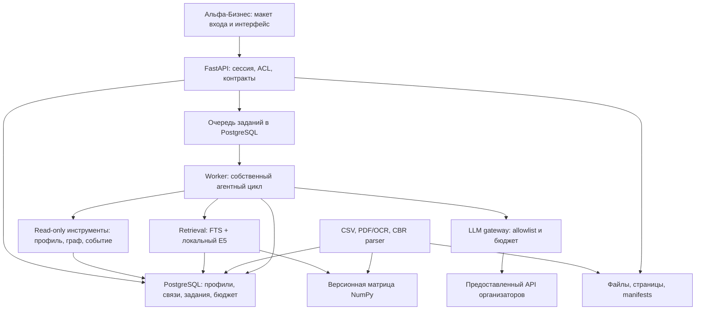

# Альфа-Хак: Новостная аналитика — окончательный план реализации

Версия плана: 1.4, 22 октября 2026; включает уточнения bootstrap-задания и официального Q&A. Срок: 7 последовательных дней. Команда: backend A, backend B, ML M. Это план работ и критерии приемки, а не отчет о готовом продукте. Измерены только результаты аудита, прямо отмеченные ниже. Пороги качества, трудоемкость и ресурсы — предлагаемые цели.


## Область этой редакции и bootstrap

Этот документ сохраняет полный недельный план, все R01–R21, WBS A/B/M,
G1/G2/G3, baseline/абляции и критерии; это не отчет о готовности продукта.
Фактический результат реализации находится в requirements.md и handoffs/BOOTSTRAP.md.
Сначала foundation: контракты → миграции/сессия → очередь/worker → synthetic путь →
нормализация/бюджет/негативные тесты → handoff → clean bootstrap.
Live LLM выключен. Реальные CBR, OCR, E5, adaptive planner и semantic verifier — следующие задачи.
Fixture runner честно маркируется synthetic/fixture/model_id=null/usage_status=not_called.
Старые результаты аудита, проверки URL и OCR ниже — исторические сведения плана 1.0;
текущий manifest отдельно отмечает реально прочитанное и измеренное.
Схемы/HTTP snippets недельного плана — проектные примеры, а не исполняемые contracts;
актуальные валидируемые примеры находятся в API_EXAMPLES.md.

## Фактическое продолжение A после ML-коммитов, 21.10.2026

База интеграции `ee2fded`; подробности и ограничения: [A02/A05 → ML](handoffs/A02-A05-ML.md).
Это обновление статуса, остальные недельные критерии ниже остаются планом.

| Этап | Фактическое изменение | Оставшаяся приёмка |
|---|---|---|
| A02 | Полный повторный аудит CSV; fail-closed CLI; явный atomic/idempotent PostgreSQL importer, quarantine/stubs/typed relations и manifest | Результаты full-size apply/rollback/repeat: [remediation](audits/d170154-remediation.md); обновление набора требует миграции multi-version company snapshots |
| A05 | Read-only ProfileProvider/RelationsProvider; server grants, authorized group subset, F/group traversal, payment edges без self-transfer | Feed scoring, shares с denominator/coverage, case F_34348 trace, nDCG/абляции |
| M02/M03 integration | Контрактные import fixes, local-only E5, pgvector/FTS migration 0002, ACL/time/savepoint, честный eval gate | OCR deps/corpus config + проверенные SHA spans, реальные local embeddings и frozen corpus quality gate |
| A04/live | Общий fake-tested ledger сохранён, live transport выключен | Тарифы/usage и общий gateway при подключении M04 |

После независимого аудита исправлены payment JOIN/COPY и worker shutdown; подробности
полноразмерной приёмки — в [remediation](audits/d170154-remediation.md).
Полный A02 apply на исходных CSV проверен: 204708 profiles, 1478586 relations,
2761118 payment features, 12 quality issues; grants=0. Late failure → нет опубликованных
rows, repeat → already_imported/counts unchanged. Import transaction 537.858 s,
probe со всеми сверками 828.637 s, importer peak RSS 174988 KiB. Цель 2–4 min остаётся
открытой; OCR/E5/feed scoring этим результатом не принимаются.
Выбранное M pgvector-хранилище сохранено. Layout не менялся. Контракты 1.0.0
совместимы; migration 0002 additive к 0001. Paid API calls: 0.

## Официальный письменный Q&A: актуализация текущего прохода

Прочитан отдельный первоисточник организаторов, №1–74. Полная матрица №10–25/69–74,
формулы self-transfer, контрактный переход и противоречия кейсу: [impact review](official-qa-impact.md).
Его SHA и происхождение отдельно зарегистрированы в inputs manifest; прежний Q&A-пересказ
не считается этим официальным файлом.

- PAY_AMT/PAY_CNT: только начало «с 1 января»; end/available_at=null. Strict as_of
  исключает агрегат при неизвестном конце. Revenue RUB/2025 и sentinel1000 сохраняются.
- №21: измерены 81.6587% суммы, 13.2929% ΣPAY_CNT и 1.9851% строк на raw valid rows;
  3% операций не подтверждены. Знаменатели/normalized отдельно; данные не подгоняются.
- №43–44: каждому инсайту bank evidence не требуется. Явно различаем external fact,
  bank_view, model inference и hypothesis; происхождение не сводится к ссылке.
- №34–41: актуальные внешние новости и их сбор входят в решение, остаются B02.
  Collector в этом проходе не добавляется.
- №3/31: формальные признаки агентности и role personalization необязательны;
  controller/CEO/CFO — выбранные средства, существующие ACL/роли сохраняются.
- №69/74: ограниченный demo pool допустим; архитектура и case logic рассчитаны на
  всю выборку. Нельзя выдавать fixed fixture runner за общий case engine.
- №71–73: hosting желателен, форматы выбирает команда, real bank integration сейчас
  не требуется. Case-specific функции сверяются с кейсом; никаких новых integrations.

Contracts write **1.1.0**, read legacy **1.0.0**; semantic rule **official-qa-2**,
import **case-csv-2**. Нужны обновлённые consumers B/M; старые данные не перезаписываются.
Миграция schema0002 и ML storage сохранены. Старые full-size замеры относятся к case-csv-1;
новые временные поля проверяются отдельно, без заявления повторной full-size приёмки v2.

## 2. Поправки к плану по транскрипции

### 2.1. Основание и приоритет

Исторический источник: предоставленная транскрипция вебинара, SHA-256 `075b5bd04b49ef2aab27c09252d6181e8364ef71bd7d94bdc1bba6e93bc182f1`. Ссылки ниже — на раздел «Транскрипция вебинара», говорящего и вопрос; номера строк фиксируют эту историческую версию; исходная транскрипция отдельно не хранится, уточнения сохранены в таблице ниже. Запись аудио не сверялась. Это предоставленная транскрипция ответов организаторов, а не заново подтвержденная видеозапись.

Для конкретных полей учитываем прямые ответы экспертов в транскрипции. Сводка и финальный Q&A того же файла — производные пересказы, не два независимых подтверждения. Общие устные формулировки не отменяют явных требований задания без разбора конкретного противоречия. Веса критериев не придумываем.

### 2.2. Решения, которые требуется изменить

| ID | Уточнение и место в транскрипции | Исправление плана / реализация | Проверка |
|---|---|---|---|
| W01 | Максим, вопрос о выручке, строки 156–159: 2025 год, рубли, 1000 — техническая заглушка | `REVENUE_COMPANY` нормализовать в Decimal RUB за 2025. Raw=1000 → value=null, quality=unknown, reason=technical_placeholder. Не превращать в нулевую достоверную выручку | 1000 и 1000.0 распознаются; исходная строка сохранена; 1001 не подменяется |
| W02 | Максим, строки 186–189: PAY_AMT в рублях, PAY_CNT в штуках, период с 01.01.2026, end неизвестен | Убрать «валюта и период неизвестны» для этих полей. Хранить общий период агрегирования, единицу, provenance семантики | Суммы Decimal; count целое; период принадлежит источнику, не выдуманной отдельной операции |
| W03 | Максим, 192–195: 82% объема — переводы между своими счетами, около 3% количества | `PAYER=BENEFICIARY` — self-transfer, сохранять для аудита, исключать из межфирменной экспозиции. Не называть все такие переводы внутрихолдинговыми между разными юрлицами | При наличии CSV пересчитать долю суммы и долю ΣPAY_CNT, отдельно долю строк. 82%/3% — слова эксперта, не результаты нового аудита |
| W04 | Максим, 138–147; Денис, 395–398 | CLOSE_CLIENT — бывший клиент с закрытым счетом. Пользовательский путь — для CLIENT с выданными сервером правами. PROSPECT/CLOSE_CLIENT можно сохранить в нормализованном наборе и использовать как разрешенный контекст, не создавать им автоматически app sessions | Demo actors привязаны только к CLIENT. CL_TYPE не заменяет ACL; права не выводятся из CSV |
| W05 | Максим, 132–135 и 162–165; Денис, 221–230 | Учитывать и выбранное юрлицо, и группу. GROUP_ID объединяет по владению/бенефициару/ЕИО, но не сообщает конкретный механизм или долю | Групповые признаки имеют coverage и provenance; group membership не расширяет права |
| W06 | Максим, 168–171: 12 строк одного ID — артефакт обезличивания | Оставить карантин неоднозначного U и audit issue. Не выбирать последнюю строку, не считать все поле этой компании доказанно пустым только по устному пояснению | При фактическом импорте показать конфликт полей и карантин; остальные компании доступны |
| W07 | Максим, 174–177: CITY_NAME — место обслуживания юрлица, RC_NAME — регион | Отдельная семантика service geography по вебинару. В задании с. 16 эти поля названы географией проживания физлица — зарегистрировать конфликт. Не использовать для проживания F, полномочий, места производства и маршрута поставок. CITY/REGION компании не переименовывать | Raw и обе трактовки сохранены; поле semantic_conflict не участвует в географическом влиянии по умолчанию |
| W08 | Максим, 150–153 и 180–183 | NEGATIVEMARK — наличие у банка достоверных сведений о ключевом собственнике; ФТС дает только страны | Нет риска из названия NEGATIVEMARK; нет личности собственника, направления импорта/экспорта и валюты из ФТС |
| W09 | Максим, 198–213 | Для неизвестных контрагентов нет полноценного профиля; тип отношений из платежа не задан | Stub-узлы, неизвестный тип отношений; нельзя реконструировать внешние имена, товары или роли поставщика |
| W10 | Ксения, 73–88: динамический оркестратор допустим, LangChain/LangGraph разрешены | Убрать категоричное утверждение «эти библиотеки запрещены организаторами». Сохраняем собственный Python-контроллер как выбранное инженерное решение, без новой зависимости | В ADR разделить разрешенность и выбор команды. Логика состояния, поиска и проверки остается своей |
| W11 | Ксения, 91–118: локальные embeddings/rerankers/classical ML допустимы; вопрос внешних AI API не разъяснен | Локальный E5 остается. Не добавлять reranker только потому, что разрешен. Не переносить разрешение на внешний embedding API и не расширять whitelist генеративных LLM | Конфигурация локального encoder, allowlist LLM; никаких скрытых внешних AI calls |
| W12 | Денис, 317–326 и 341–344 | Не каждый инсайт обязан иметь банковский тезис. Обязательна маркировка источника и AI-вывода; существенный вклад банка в продукт по заданию сохраняется | `bank_evidence_status=not_found` допустим; нельзя выдумывать bank_view. Абляция банка остается |
| W13 | Денис, 365–368 | Добавить обязательный для прототипа дисклеймер «Не является индивидуальной инвестиционной рекомендацией». Для AI — отдельную отметку, что это не официальная позиция банка | Notice IDs/тексты в ответе анализа и отображение UI, включая сохраненные и частичные ответы |
| W14 | Денис, 371–428, 544–550 | Веб-раздел внутри авторизованной зоны; заметный вход; проверка связи пользователя с компанией предполагается выполненной банком | Смоделированная bank session, общий app shell, без регистрации, реального SSO, банковского API, лендинга/расширения |
| W15 | Денис, 263–272 и 389–392 | Ручная роль — плюс и выбор команды, не отдельное обязательство вебинара. Для нашего продукта CEO/CFO/unknown сохраняются | Смена роли меняет задачу/акцент, не факты, банк и права |
| W16 | Денис, 281–296, 469–472; Максим, 523–526 | Источники выбираем сами, бесплатные и законные. Создание потока — часть решения. Выданные PDF комбинируются с актуальными новостями | CBR adapter в недельной поставке; импорт по запросу уже полезен, scheduler вторичен. Старый PDF не автоматически текущая позиция |
| W17 | Максим, 511–514: кликабельность nice to have; задание с. 8 требует работающий интерактивный прототип | Рабочий интерфейс и сквозная проверка остаются. Общее устное замечание не отменяет письменную сдачу | Docker + interactive path, не только Figma |
| W18 | Денис, 311–314: отчет по стали «похож на Commodities», предложено сопоставить | Steel 2021 можно классифицировать как commodity/steel, но не утверждать, что отсутствующий отдельный Commodities performance найден. Дату 2021 сохранить | Старый отчет не применяется как текущая количественная аналитика 2026 |
| W19 | Денис, 535–574, эксперты 583–586 | Короткий путь к инсайту, ограниченный demo pool, алгоритм для всей выборки | Небольшой UI, метрика времени до первого полезного инсайта; нет hardcode только demo U |

### 2.3. Временная согласованность: важное исправление

Официальный Q&A №20 подтверждает только начало «с 1 января». End=null и available_at=null; дата 31.10.2026 из прежней транскрипции больше не используется как подтверждённое окончание. Суммы не обрезаются пропорционально времени, дата файла/импорта не становится доступностью источника.

Вводим `temporal_mode`:

- `snapshot_demo`: анализ на предоставленном учебном снимке. UI и eval report явно показывают период данных. Это не исторический прогноз того, что система знала в сентябре, и не доказательство отсутствия временной утечки.
- `strict_as_of`: источник должен иметь подтвержденную дату доступности не позже as_of; у агрегата также `period_end<=as_of`. Неизвестная доступность, неизвестный конец агрегата или окно из будущего → признак исключается, возвращаются availability_unknown/aggregate_end_unknown/future_aggregate. Окончание окна само по себе не доказывает доступность выгрузки.

Для revenue период 2025 известен, но конкретная дата доступности клиентского snapshot не дана. Для продуктовых флагов/связей отчетная дата также не известна. Не приписывать им историческую доступность по периоду выручки.

Тесты разделить: (1) время новостей/банковских документов и отсутствие future retrieval; (2) персонализация на фиксированном snapshot; (3) строгий as-of с явно заданными временными fixtures. Не называть совокупный snapshot-тест историческим backtest. В групповых и платежных derived features передавать `depends_on_source_versions`, `period`, `available_at`, `temporal_status`.

### 2.4. Группа и платежи: что теперь можно считать

Выручка RUB/2025 позволяет убрать прежнее предположение об единице, но не дает долю рынка или консолидированную выручку группы. В приложении не ставить жесткий фильтр «показывать только U с выручкой >15 млрд»: крупный бизнес обсуждается по группе; это может исключить нужную дочернюю компанию. Основной допуск — CLIENT и server grant.

Для группы возвращать разрешенные пользователю компании, отрасли и признаки с provenance. `observed_group_revenue_sum` допустима как сумма доступных валидных годовых выручек с явным отсутствием консолидационных исключений. Не называть ее консолидированной выручкой, не определять по ней окончательный сегмент. Не раскрывать скрытых участников/их суммы/даже общий размер группы через непроверенные агрегаты. `group_segment=unknown` допустим.

При разрешенном snapshot и проверке повторов платежей можно вычислять долю наблюдаемых исходящих межфирменных платежей:

`share(U,V) = sum_valid_amount(U→V) / sum_valid_amount(U→W, W!=U)`.

Условия: RUB, одинаковое окно, положительный знаменатель, корректный набор, исключение self-edge. Точные дубли удаляются только в normalized слое с записью причины; повторные пары с неодинаковыми агрегатами без объяснения не складываются. Плательщик с такими повторами не получает «точную долю»: metric=null либо отдельно обозначенный partial расчет, который не используется как полный denominator. Не считать платежи, скрытые ACL, способом выдать чужие суммы; собственные исходящие записи должны иметь самостоятельное право доступа.

Это доля наблюдаемых переводов за период, не закупок, выручки, себестоимости или доказанной зависимости. В bootstrap реализовать нормализацию и диагностические суммы, advanced shares оставить следующему пакету A05. Процентные эффекты от изменения ставки по-прежнему нельзя считать без условий/остатка долга.

### 2.5. Изменения контрактов, приемки и задач

Добавить:

- `Feature`: raw_value, normalized value, unit, period_start/end, available_at, quality_reason, semantic_source_ref, temporal_status.
- `GroupContext`: group_id, visible_company_ids, coverage=`authorized_subset`, feature refs, consolidation=`not_performed`, segment=`unknown|confirmed` с источником подтверждения.
- `AnalysisRequest`: temporal_mode и as_of; company/principal/ACL берутся с сервера.
- `Analysis`: notices[], temporal_warnings[], context/source versions; mode=`fixture|live|cache|saved_replay|evidence_only`.
- `Notice`: id, text, kind=`investment_disclaimer|ai_attribution|synthetic_data|temporal_limitation`.
- `DataQualityIssue`: source/row/field, code, severity, safe_behavior, resolved_by_source_ref.

Новые обязательные regression cases: sentinel 1000; RUB/2025 и платежное окно; типы клиентов; различие self/group; отсутствие консолидации; service geography conflict; исключение future aggregate; disclaimer; no-bank insight без ложной атрибуции; group ACL; неизменность facts/grants при смене роли.

A02 владеет новой семантикой/import; A03 — eligibility/grants/context; A05 — group/payment features; M01/M06 — корректной временной оценкой; B03 — notices/app shell/history. A01 фиксирует контракт до разделения разработки. Недельный бюджет 126 плановых часов +21 резерв сохраняется: новые проверки входят в A02/A03/A05/M01/M06/B03, не создаем новую большую ветку. Если возникает перерасход — использовать резерв и убрать второй источник/декоративный UI; не сокращать доказательства и сквозную проверку. Метрики нового продукта еще не измерены.


## Существенные изменения

| Изменение | Что фиксируем |
|---|---|
| Персонализация по человеку | Компания, пользователь, роль, потребности и права — разные сущности. CEO/CFO — два демонстрационных пресета; остальные роли не запрещены. |
| Уточнены разрешения | `openai` допустим как HTTP-клиент указанного шлюза. Локальные embeddings разрешены. Это не разрешение внешних embedding API или готовой агентной системы. |
| Проверена инструкция | Точные API-ID, один общий бюджет 500 ₽/день, сброс в 03:00 МСК. Ни цены, ни доступность генеративных моделей пока не подтверждены запросом с ключом команды. |
| Исправлена семантика данных | Физлицо не равно владельцу или пользователю; платеж не доказывает поставку; продуктовый флаг не раскрывает сумму и условия договора. Выручка RUB за 2025; 1000 — техническая заглушка, normalized=null. |
| Повторен аудит | CSV перепроверены с SHA-256; конфликтующий профиль изолируется. Реальный путь через физлицо включен в тесты. |
| Зафиксирован поиск | PostgreSQL FTS + локальный `intfloat/multilingual-e5-small`, NumPy, без отдельной векторной БД. Retrieval отделен от ранжирования событий. |
| Зафиксированы интеграции | Смоделированная сессия Альфа-Бизнеса; реальный парсер ЦБ; ручной ввод и сохраненный показ явно маркируются. |
| Согласованы границы работ | Общие схемы, один владелец миграций, задания агентам с ограниченными путями, 126 плановых человеко-часов + 21 час резерва. |

## 1. Источники, ограничения и матрица требований

### 1.1. Что доступно и действительно проверено

При подготовке исходного плана были предоставлены задание на 19 страницах, инструкция по ключам на 1 странице, пересказ вебинара, три CSV и девять аналитических PDF. Девять аналитических PDF содержат 64 страницы без текстового слоя; текст получен OCR, значимые числа и таблицы сверялись с изображениями. В исторической проверке плана 1.0 получены хеши, число страниц и аудит CSV; OCR всех страниц заново не запускался. Отдельного нового файла «текущий план» среди доступных вложений нет: перерабатывается предыдущая версия обсуждения. Два альтернативных плана не доступны как отдельные файлы в текущем наборе; повторную проверку их полного текста не заявляем. Никакие числа из них не принимаются вместо аудита.

Не приложен `Commodities performance`, перечисленный в задании, с. 17. Вместо него среди доступных материалов есть дополнительный отчет по стали 2021 года. Из вебинара известны RUB/2025 и платежное окно с 01.01.2026, end неизвестен. Нет подтвержденной даты доступности snapshot, договорных условий кредитов/лизинга, имен обезличенных организаций, реального пользовательского каталога и API Альфа-Бизнеса. Наличие/содержимое локальных секретов не проверяется; не подтверждены тарифы шлюза, точного времени дедлайна и регламента длительности защиты.

Порядок трактовки: исходное задание задает кейс; отдельная инструкция конкретизирует подключение; прямые ответы организаторов разрешают только указанные вопросы; пересказ вебинара помогает понять замысел, но не создает новые обязательства. Инженерные решения ниже имеют собственные критерии проверки и не объявляются правилами жюри. Веса критериев не опубликованы и не назначаются.

### 1.2. Разночтения

| Вопрос | Формулировки и источник | Решение |
|---|---|---|
| Кто пользователь | Задание, с. 5: сервис «для людей, а не для юридических лиц»; несколько пользователей одной компании | Учитывать роль и потребности человека отдельно от профиля компании. Только CFO — неверное ограничение. |
| Рыночная доля | Задание, с. 6 просит определить положение и долю рынка; в данных нет объема соответствующего рынка | Поле `market_share=null`, причина `missing_market_denominator`. Не считать долю компании в выборке долей рынка. Отобразить ограничение, запросить данные. |
| Физлица и платежи | С. 16: физлица используются «для анализа связей между организациями». Сводка: «связи через бенефициаров», «поставщиков и покупателей по графу платежей» | Сохранять типы `shared_person` и `observed_payment`; владение и поставку не утверждать. |
| Кредитный флаг и ставка | В сводке сохранение 14% названо риском роста обслуживания долга. CSV содержит только флаг продукта | Сохранение ставки не является повышением; возможна задержка ожидаемого удешевления. Зависимость платежа от ставки проверяется по договору. |
| Банковские продукты | С. 13: сводка «может содержать» нативную рекламу. В сводке перечислено как часть действий | Продажи продуктов исключаем из недельного объема. Вопрос о финансировании не превращаем в персональную рекомендацию продукта. |
| Смена ролей на защите | Сводка называет ее обязательной. С. 5 подтверждает разные потребности; с. 8 не задает именно этот тест | Сохраняем как выбранную проверку персонализации. Официальный Q&A31 подтверждает необязательность ролей; это не официальный обязательный тест. |
| Embeddings | Задание не конкретизирует; прямое уточнение №3 разрешает локальные embedding-модели | Допустимость закрыта. Внешние embedding API не используем. |
| OpenAI SDK | Инструкция, с. 1 содержит `from openai import OpenAI`; уточнение №1 разрешает HTTP-клиент | SDK не является агентным движком. Только указанный base URL и whitelist моделей. |
| Название платежного файла | С. 16 повторно пишет `df_Fid_Uid_link_hack.csv` под платежами | По фактическим колонкам платежи читаем из `df_Uid_payment_hack.csv`; исправление фиксируем в словаре данных. |
| Кодовые агенты | С. 18 запрещает другие LLM и внешние AI/готовые автономные решения как основной компонент. Инструкция по ключам не обсуждает инструменты разработки | Пользователь выбрал Codex как средство разработки; runtime whitelist от этого не расширяется. Не встраивать его в продукт. |

### 1.3. Матрица реализации

Категории: **О** — обязательное требование/ограничение задания; **К** — критерий оценки; **Рз** — разрешение; **Рк** — рекомендация; **И** — наше инженерное решение; **П** — прямое требование пользователя к этому плану. Пакеты A/B/M описаны в разделе 10.

| ID и требование | Источник | Статус | Реализация / задача / владелец | Приемка | Демонстрация |
|---|---|---|---|---|---|
| R01 Контекст компании и группы, масштаб, деятельность | Задание, с. 4, 6, 15–16 | О | Версионные профили, типизированные связи; A02/A05, A | Импорт всех CSV; неизвестная доля рынка не вычисляется | Раскрыть признаки и ограничения |
| R02 Пользователь — представитель с потребностями | С.5; официальный Q&A31–32 | О: компания/потребности; И: роли | Сессия, роль, задачи, ACL отдельно; A03/B01, A/B | Две роли, неизвестная роль, неизменные права | Одна компания, CEO → CFO |
| R03 Парсер внешних новостей и банковских материалов | С. 6 | О | CBR RSS+HTML; PDF/OCR; B02/M02, B/M | Реальный импорт новой публикации, страницы и hashes | Новая новость не из кеша |
| R04 Персональные отбор и ранжирование | С. 6; с. 9 критерий 1 | О/К | Объяснимый скоринг; A05/M04 | Контрфактические тесты, nDCG@5 против baseline | Две компании одной отрасли |
| R05 Содержательная интерпретация и шесть вопросов | С. 6, 11, 14; с. 9 критерии 5–6 | О/К | Шесть разделов, механизм, условия, альтернативы; M04/M05, M | Ручная рубрика, отсутствие неподтвержденных эффектов | Раскрыть карточку |
| R06 Значимый вклад банка и отличие от AI | С.9,11; официальный Q&A43–44 | О/К для продукта; не каждому инсайту | BankThesis и отдельные claims; M02/M04/M06 | Абляция банковского корпуса | Сравнить прежний и новый прогноз |
| R07 Объяснимая архитектура/контроллер | С. 7,10; официальный Q&A3–5 | И; формальная агентность необязательна | Собственный контроллер, инструменты, проверки; M04/A04 | Разные трассы, повторный поиск, остановка | Показать краткий журнал действий |
| R08 Полный путь и вход из Альфа-Бизнеса | С. 6, 8; с. 10 критерий 8; уточнение №2 | О/К | Смоделированный главный экран и сессия; B01/B03/B04 | Сквозной тест | Пройти от входа до ответа |
| R09 Источники и уточняющие вопросы | С. 10 критерий 9; с. 14 | К/О | Evidence drawer, PDF page, диалог; B03/M04 | Ссылка поддерживает утверждение; контекст диалога изолирован | Уточнить условия кредита |
| R10 Неизвестные/шумные данные, конкретная компания | С. 12 | О | Null/unknown/conflict, карантин, conditional claims; A02/M05 | Неизвестная валюта, конфликт профиля, неподходящий тезис | Корректный частичный результат |
| R11 Только разрешенные LLM и общий лимит | С. 12, 18; инструкция, с. 1 | О | Gateway allowlist, ledger, лимиты; A04/M07 | Нельзя вызвать чужую модель/URL; бюджет останавливает все процессы | Сбой/исчерпание бюджета |
| R12 Безопасность | С. 12 | О — описать и показать место достаточно | Реализовать ACL, секреты, read-only tools, лимиты; A03/A06 | Межпользовательская изоляция, prompt injection, SSRF | Краткая схема; технические тесты |
| R13 Качество на новых новостях | С. 9 критерий 4 | К | Temporal holdout и live import; M01/M06/B05 | Отложенные события и некешированная публикация | Своя новая публикация; организаторы не обещают входной файл |
| R14 Трассируемость, объединение источников | С. 9 критерий 3; с. 10 критерий 11 | К | Evidence IDs, версии, trace; A01/M05/B03 | Восстановить цепочку каждого существенного вывода | Открыть источник и строку CSV |
| R15 Метрики и сопровождение | С. 10 критерии 7, 12 | К | Прогон eval, latency/cost/errors, feedback; A06/M06/B07 | Отчет с знаменателями и limitations | Таблица измеренных результатов |
| R16 Комплект сдачи | С. 8, 19 | О | GitHub, commit, README, Docker, locks, notices, synthetic fixtures; A08/B07 | Чистый запуск другим человеком | Самостоятельный сценарий жюри |
| R17 Структурированный JSON | С. 13 | Рк → И | Pydantic/JSON Schema/OpenAPI; A01 | Contract tests | Ошибки и partial имеют схему |
| R18 Внешний сервер | С. 8 | Рк | Только после локальной приемки; B07 | Доступность демо, ключ на сервере | URL при наличии |
| R19 Локальные embeddings | Прямое уточнение №3 | Рз → И | E5 локально; M03 | Retrieval ablation, offline fallback | Источники находятся перефразированным вопросом |
| R20 SDK и отсутствие регистрации | Уточнения №1–2; инструкция, с. 1 | Рз/уточнение | SDK только transport; mock bank session | Нет отдельной регистрации/внешних AI API | Вход одной кнопкой |
| R21 Командная разработка и кодовые агенты | Текущий запрос пользователя | П/И | Контракты, worktrees, handoff; A01/A08 | Проверяемые пакеты и ревью | В README development process |

## 2. Один пользовательский сценарий

Строим **«Что это событие меняет для моей работы в этой компании?»** для представителя крупного бизнеса. Основная задача — выбрать 2–3 события для внимания, понять механизм возможного влияния и получить следующий полезный вопрос. Польза наблюдаема: пользователь отличает факт от прогноза, понимает релевантные признаки своей компании, находит источник и видит, какое неизвестное условие нужно выяснить.

Минимальный путь: **главная Альфа-Бизнеса → заметный пункт «Новостная аналитика» → смоделированная сессия → разрешенная компания → роль/потребность → лента → событие → доказательства → уточняющий вопрос**. B отвечает за весь интерфейс и сквозную интеграцию. A отвечает за серверный контекст и права. M — за смысл анализа.

На главном экране — только макет навигации и вход, без банковских операций. Сервер получает `demo_actor` из фиксированного тестового набора и создает сессию. Это **смоделированная интеграция**, а не реальный SSO. Реальный импорт CSV/PDF, поиск, API, агент и CBR parser работают. Отдельной регистрации нет. Будущий bank ticket обозначен интерфейсом адаптера, но не обещается реализованный API банка.

| Сущность/поле | Происхождение | Назначение и запрет |
|---|---|---|
| Компания, продукты, ОКВЭД, группы | CSV, версия и строка | Бизнес-контекст, не права человека |
| Связь F–U | CSV связей | Связь организаций через общий F, не должность/владение/логин |
| `principal_id`, `session_id`, grants | Серверный demo manifest | Смоделированная банковская сессия, не вывод из F |
| `role` | Самостоятельный выбор пользователя, `source=user_declared` | Потребности; не доказательство должности и не расширение ACL |
| `needs`, `horizon_days`, `detail` | Пресет роли или явный выбор с признаком происхождения | Ранжирование и изложение |
| Допущения/ответы | Явно введены в текущем диалоге | Условие сценария, не изменение исходного профиля |
| Права | Только grants сессии | Проверяются при каждом чтении/задании/ответе; роль их не изменяет |

Роли: `ceo`, `cfo`, `treasurer`, `chief_accountant`, `owner`, `other`, `unknown`. За неделю вручную прорабатываем два пресета CEO/CFO; для остальных — общий шаблон плюс выбор потребностей, без запрета пользоваться сервисом. Unknown: нейтральный деловой обзор, горизонт 90 дней, вопрос «Что для вас приоритетнее: финансирование, операции или развитие?». Отсутствие ответа не блокирует ленту.

CEO: непрерывность операций, коммерческие условия, инвестиционные решения, горизонт до 365 дней. CFO: ликвидность, сроки пересмотра условий, финансирование, 0–90 дней. Эти горизонты — defaults с возможностью изменения. Роль меняет порядок релевантных тем, акценты, детализацию и следующий вопрос. Факты, значения, даты, позиция банка и доказательства при неизменных компании/event/as_of сохраняются. Роль сама по себе не меняет знак влияния. Core facts события и применимый базовый набор BankThesis фиксируются до ролевого представления; при смене роли переиспользуются их IDs/версии. Новые ролевые акценты не переписывают этот набор.

### 2.1. Три обязательных сравнения

Один инфоповод из материалов кейса: 11.09.2026 ставка оставлена 14%; банк пересмотрел прогноз конца 2026 с 13,5% до 14% (отчет о ставке, с. 1). Это описание **события в материалах кейса**, не заново проверенное официальное сообщение ЦБ.

| Контекст | Неизменные факты | Персональный акцент / следующий вопрос |
|---|---|---|
| U_15728, CEO | ОКВЭД 52.29, кредитный и лизинговый флаги 1; условия договоров неизвестны | Инвестиционный план не должен автоматически предполагать быстрое удешевление финансирования. «Какие проекты зависят от нового финансирования до конца года?» |
| U_15728, CFO | Те же факты и прогноз банка | Проверить даты пересмотра ставок/рефинансирования, не рассчитывать рост платежа. «Какая часть договоров имеет плавающую ставку и когда ближайший пересмотр?» |
| U_11496, CFO | Тот же ОКВЭД; кредитный флаг 0, лизинг 1; есть страны ФТС | Кредитная экспозиция этим датасетом не подтверждена. Уместен вопрос об условиях лизинга/новом финансировании. 0 не означает отсутствия долгов во всех банках. |
| U_15728, unknown | Все исходные факты сохраняются | Кратко объяснить условную чувствительность и предложить выбрать задачу. Не угадывать должность по продуктам или F. |

## 3. Аудит и использование данных

### 3.1. Исторический аудит CSV из плана 1.0

Исторический отчет автора плана 1.0, не измерение bootstrap: Python **3.12.14**, pandas **2.2.3**, `read_csv(sep=';', dtype='string')`; флаги нормализуются численно, потому что в файлах записаны `1.0` и `0.0`. Скрипт `reproduce_audit.py` и полный `input_audit.json` приложены к документу в архиве аудита. Номер строки для интерфейса = `row0 + 2`, с учетом заголовка.

```bash
python reproduce_audit.py /path/to/input > input_audit.json
```

| Файл | Строки / колонки | SHA-256 |
|---|---:|---|
| df_Uid_data_hack.csv | 85 525 / 24 | `cb48983806ce7ca0ae045a40c9627ccbe47cc72bfb54058db04df2386da4a983` |
| df_Fid_Uid_link_hack.csv | 12 514 / 4 | `3d9c718e2a87304f48bbc7447607116bb8e4bd61dded70b0a1d0558f086a1b58` |
| df_Uid_payment_hack.csv | 1 380 585 / 4 | `30095f75bead1a1dac0d7232b0da09a326b7ef643ee3b77b36ad3b4458a1cab3` |

В историческом отчете измерено (новый аудит публикуется отдельно):

- Компании: 85 514 уникальных U, 18 098 групп. `U_428697` имеет 12 различных строк; весь его профиль карантинируется. Полных дублей нет. `ECO_MARK_LABEL` отсутствует в 4 157 строках, СПАРК-штат — в 85 357, страны ФТС — в 77 179. Есть 224 строки с FTS=1 без страны и 206 с FTS=0 при заполненной стране. Значение `CLOSE_CLIENT` встречается 6 858 раз, `CLIENT` — 41 968, `PROSPECT` — 36 699; CLOSE_CLIENT по вебинару — бывший клиент с закрытым счетом.
- 115 строк имеют сырое значение выручки >15 млрд. Это историческое число строк, а не допуск в приложение: выручка RUB/2025, сегмент обсуждается по группе; app eligibility = CLIENT + server grant, без порога 15 млрд.
- Связи: 11 120 F, 12 307 U, 7 885 строк ведут к U без профиля; это число строк, не число уникальных неизвестных U. В 14 строках нет города/региона. 243 F связаны минимум с двумя известными неконфликтными компаниями. Географические значения F могут различаться между строками; встречаются обозначения вроде «Мск Север» и банковских региональных зон. Их не превращаем автоматически в точный адрес или административный регион; они не становятся атрибутом пользователя.
- Платежи: пропусков нет, суммы и количества парсятся, отрицательных/нулевых значений не найдено; 1 точный дубль, 17 дополнительных строк повторных направленных пар, 27 406 self-edge. В 582 165 строках неизвестен профиль плательщика, в 409 024 — получателя; эти множества пересекаются, их нельзя складывать как число испорченных платежей.

### 3.2. Входы и происхождение

| Вход и реальные поля | Проверки | Преобразование / хранилище | Использование | Что увидит пользователь / ограничения |
|---|---|---|---|---|
| Компании: `SYNTHETIC_U`, `ORG_TYPE`, `OKFS_NAME`, `COMPANY_AGE_YEARS_GRADATION`, `ECO_MARK_LABEL` | Уникальность ID, категории, конфликт строки | Raw import + CompanySnapshot/Feature | Масштаб/стадия как вспомогательные признаки, если релевантны | Файл, строка, raw/normalized; не оценка кредитоспособности |
| `MAINOKVED_CODE`, `MAINOKVED_NAME`, `CITY`, `REGION` | Согласованность кода/описания, нормализация топонима | Industry tags, registered geography | Отбор отраслевых/географических событий | Основной ОКВЭД не описывает весь ассортимент; регистрация не доказывает место операций |
| `REVENUE_COMPANY`, два `AMOUNT_WORKERS_*_GRADATION` | Decimal; разные источники штата не объединяются молча | Value + period/year/unit-known flags | Условный масштаб; никакой финансовой арифметики без единиц | Годовая выручка RUB/2025, 1000 → unknown; дата доступности неизвестна; диапазон штата не точное число |
| `NEGATIVEMARK`, `GROUP_ID` | Словарь с. 15; неизвестные группы | Признак ключевого собственника; group membership edge | Подтвержденное наличие признака/общей группы | NEGATIVEMARK не негативный риск. Нет личности владельца, долей и контроля |
| `CL_TYPE`, `CL_PRODUCT_RKO/GAR/LOA/LEA/DEP/ZPP_MARK`, `FACTORING_MARK` | Нормализация 0.0/1.0; неизвестная категория | Трехзначные flags: true/false/unknown | Возможная релевантность финансирования/ликвидности | 1 = продукт отмечен в выгрузке. Нет баланса, ставки, срока. 0 ≠ отсутствие продукта вне выгрузки |
| `FTS_FLAG`, `FTS_COUNTRY_NAME` | 224/206 конфликтов; список стран | Сохранять флаг и страны отдельно, `inconsistent` | Страновая тема с оговоркой | Нет направления импорт/экспорт, валюты, товарной структуры или доли |
| F–U: `SYNTHETIC_F`, `CITY_NAME`, `RC_NAME`, `SYNTHETIC_U` | Дубли, неизвестные U, противоречащая география | PersonLink, typed shared_person path | Дополнительные связанные компании в разрешенном контексте | Только связь через общий обезличенный F. Не ACL, не account, не бенефициар |
| Платежи: `PAYER`, `BENEFICIARY`, `PAY_AMT`, `PAY_CNT` | Decimal, повторы пары, self, неизвестные узлы | Raw rows + payment edge status, без произвольного суммирования конфликтов | Подтвержденная наблюдаемая связь и вопрос о характере отношений | Сумма Decimal RUB, количество в штуках, общий период с 01.01.2026, end неизвестен. Не поставка, не выручка, не частота в месяц |
| PDF банка | SHA, дата документа/данных, OCR, страницы, таблицы, сноски | DocumentVersion → Page → Chunk → Evidence/BankThesis | Retrieval доказательств, прогноз/позиция банка | PDF-страница и выделенный фрагмент, дата, actual/forecast, OCR verification |
| Внешние новости | URL/GUID, дата, source family, content hash, corrections | Raw body → DocumentVersion/EventVersion | Классификация, факты, ранжирование | Реальный URL, время загрузки; отдельно case/live/manual |
| Настройки/уточнения | Enum, длина, источник, срок действия, principal | UserContextVersion и Conversation assumptions | Приоритеты/условные сценарии | «Указано вами»; не переписывает CSV и не передается другому пользователю |

### 3.3. Производные признаки и запреты

| Признак | Правило и поля | Допустимая интерпретация / что запрещено |
|---|---|---|
| `industry_tags` | Нормализовать основной ОКВЭД по версионному словарю, сохранить исходный код | Отраслевая применимость; не точный продукт или ценовая экспозиция |
| `scale_candidate` | Валидная выручка RUB/2025; sentinel=1000 исключается | Наблюдаемый масштаб юрлица; не фильтр допуска, не сегмент группы |
| `observed_credit_product` | Нормализованный LOA; аналогично другим флагам | Повод спросить об условиях; не сумма долга и не плавающая ставка |
| `shared_person(U,V)` | Есть строки (F,U),(F,V), U≠V; обе компании разрешены | Подтвержденная связь через F; не экономическая передача шока |
| `same_group` | Равные ненулевые GROUP_ID | Общая группа в данных; не автоматически общие права или гарантии |
| `payment_link` | Есть уникальная неповторяющаяся пара PAYER→BENEFICIARY; сохранять row refs | Наблюдаемый перевод; не supplier/buyer |
| `raw_avg_payment` | PAY_AMT/PAY_CNT, только валидные положительные поля одной строки | Средняя сумма операции в исходных единицах; в MVP не используется для выводов |
| `counterparty_share` | Σ amt для контрагента / Σ amt по сопоставимым переводам данного плательщика | RUB/окно подтверждены вебинаром; A05 после контроля повторов может считать долю наблюдаемых межфирменных переводов. Bootstrap считает диагностические суммы, advanced shares отложены. Не доля закупок/выручки |
| `neighbor_topic_match` | Событие подходит признакам разрешенного соседа и существует typed path | Повышение внимания/следующий вопрос; без подтверждения отношений нельзя утверждать косвенный убыток |
| `market_share` | Выручка компании/объем соответствующего рынка за одинаковый период и периметр | Сейчас null: нет внешнего сопоставимого рыночного знаменателя |

Повторяющиеся платежные пары: точный дубль удаляется только в нормализованном слое, raw сохраняется; неточные повторы получают `ambiguous_aggregate` и не суммируются без понимания периода. Self-edge не участвует в межфирменных признаках. Неизвестный U хранится как stub без выдуманного профиля; отсутствие профиля не означает отсутствие компании. Компания с конфликтом не получает «последнюю» строку по произвольному порядку.

Весь набор импортируется и проверяется, но не весь передается модели. При импорте: аудит, нормализация, индексы U/F/групп/платежей, OCR и chunks. При обновлении: только измененные файлы/строки/документы, новый snapshot и индекс. При открытии ленты: ACL-filtered профиль, типизированные связи, отбор до 100 событий, детерминированное ранжирование, 10 карточек. При анализе: не более 15 релевантных признаков, 5 доступных соседей, 10 ребер, 8 chunks; предел контекста и provenance обязательны. Отсечение раскрывается как `truncated=true`. LLM не получает полные CSV, весь граф, лишнюю географию F, чужие продукты и произвольные секреты.

Внешние новости сопоставляются с обезличенными клиентами по отрасли, регистрации, странам ФТС, продуктовым/структурным признакам с ограничениями выше. Новость об именованной компании не сопоставляется с U по догадке. Названный контрагент применим напрямую только при подтвержденном mapping из разрешенного источника; в текущем наборе его нет. Связи внутри обезличенного графа не раскрывают внешнее имя.

### 3.4. Банковский корпус

| Документ | Дата / страницы | Значимые места, контроль и применение |
|---|---|---|
| ALFA_Russian_Steels_1К21PreviewUpdate_15Apr2021 | 15.04.2021 / 4 | С. 1–2 прогнозные таблицы, USD млн; не путать прогноз EBITDA с исторической колонкой. С. 3 мультипликаторы; с. 4 disclaimer. Только ретроспектива, не текущие доказательства 2026. |
| FI_Strategy_3Q26_22072026 | 22.07.2026 / 27 | С. 10 рыночная доля плавающих кредитов не переносится на клиента; с. 18 сноски состава; с. 21 разные периметры выпуска/вложений; с. 24–26 цены, доходности, дюрация и сроки не смешиваются; с. 27 disclaimer. |
| ALFA-macro_stat1H26 | 31.07.2026 / 5 | С. 1 факт 1П и прогноз года различаются; с. 3–4 таблицы/звездочки прогноза; с. 5 disclaimer. |
| ALFA-consumption | 05.08.2026 / 4 | С. 1 прогноз потребления, с. 2 макропрогноз, с. 3 сбережения. Старый прогноз ставки не текущая позиция после 11.09. |
| Inflation_tracker_02 | 02.09.2026 / 3 | С. 1: бензин +0,91% н/н после +0,89%; дизель почти без изменений; CPI −0,01%. Банк отдельно оценивает топливный риск. С. 2 декомпозиция; с. 3 disclaimer. |
| ALFA-7M26 | 07.09.2026 / 4 | С. 1 розница июля, с. 2 рынок труда, с. 3 таблица прогнозов. Годовой прогноз ставки 13,5% — версия до пересмотра. |
| Gold_digest_August26 | «Август 2026» / 8 | С. 2–3 сценарии цены — прогноз; с. 6 есть данные на 07.09: нельзя считать файл доступным в августе по обложке. С. 7 покупки центробанков/единицы перепроверять. С. 8 disclaimer. |
| ALFA-Macro_Insights-Policy_Rate_11Sep | 11.09.2026 / 4 | С. 1 пауза 14% и пересмотр прогноза; с. 2 конец года ≠ среднегодовое значение; с. 3 графики; с. 4 disclaimer. |
| Бонд_Бриф_14092026 | 14.09.2026 / 5 | С. 1 ставки/ОФЗ, с. 2 Полюс: рейтинг/раскрытие ≠ немедленное ухудшение бизнеса, с. 3 РусГидро, с. 4 графики, с. 5 disclaimer. Нельзя сопоставить эмитента с U без mapping. |

OCR pipeline продукта: pypdf проверяет слой; pypdfium2 рендерит 250–300 dpi; Tesseract `rus+eng` дает текст и bbox. Разметка колонок и таблиц сохраняется; строка таблицы индексируется с заголовками, единицей, периодом и сноской. Из графиков не извлекаем точные числа автоматически. Неразборчивый количественный фрагмент — `unverified`, не основание численного вывода. Ключевые 15–20 fragments для демо/gold проверяются человеком; остальные доступны как непроверенный OCR с ограничениями. Полный корпус индексируется, ручная проверка каждой ячейки 64 страниц за неделю не обещается.

Даты храним раздельно: `published_at`, `available_at`, `data_as_of`, `event_at`, `ingested_at`. При неизвестном available_at строгий historical eval документ не использует; нижняя граница Gold по данным не равна доказанной дате публикации. Для case-demo может быть явно задан проверяющим cutoff с отметкой допущения, но это не результат временного backtest. Для обновленных прогнозов хранится `supersedes` при совпадении метрики, горизонта и субъекта. Перепечатки не считаются независимыми источниками.

### 3.5. Эталон качества: три ручных разбора до архитектуры

**G1. Прямой канал, чувствительность финансирования.** Событие кейса 11.09.2026: ставка сохранена 14%. Профиль U_15728: строка 3972, ОКВЭД 52.29, LOA=1, LEA=1, условия договоров неизвестны. Банк, отчет о ставке, с. 1: прогноз конца 2026 поднят с 13,5% до 14%; прогноз конца 2027 12% сохранен. Механизм: если предстоят новые заимствования/пересмотр плавающих ставок, ожидание быстрого удешевления финансирования становится слабее. Возможные последствия: пересмотр допущений бюджета/сроков проектов. Это гипотеза AI на подтвержденных предпосылках; не утверждение роста платежа. Альтернатива: фиксированная ставка, отсутствие рефинансирования и достаточная ликвидность делают ближайшее влияние небольшим. Вопрос CFO — о структуре ставки и датах; CEO — о проектах, зависимых от финансирования. Для U_11496 того же ОКВЭД LOA=0, LEA=1: кредитная экспозиция не подтверждена, вопрос смещается к лизингу/новому финансированию. Разные акценты обоснованы, разные знаки эффекта не выдумываются.

**G2. Возможный косвенный канал через реальную связь.** Событие по банковскому обзору от 02.09.2026 за неделю 25–31.08: бензин +0,91%, дизель почти без изменения; позиция банка — топливный инфляционный риск не исчерпан (Inflation tracker, с. 1). U_5639 — оптовая торговля 46.90, строка 1563. В платежах строка 10903: U_5639 → U_25605, PAY_AMT=3167679000.0, PAY_CNT=117; обратная строка 194833: 2665938000.0 и 54. U_25605, строка 6163, ОКВЭД 52.29. Факт: наблюдаемая платежная связь с организацией вспомогательной транспортной деятельности. Механизм **при условии**, что это оплата перевозок с чувствительностью к бензину: возможна переоценка транспортного тарифа и сроков оборотного капитала. Альтернатива: перевод — заем/внутригрупповой расчет; транспорт работает на дизеле; топливо уже захеджировано/тариф фиксирован. Нельзя переносить +0,91% на логистические расходы клиента или на платежную сумму. Следующий вопрос: «Что оплачивается этому контрагенту, какой вид транспорта и как меняется тариф?» Если у сессии нет прав на профиль соседа, остается только собственная платежная связь и вопрос; продукты/отрасль закрытого соседа не раскрываются.

**G3. Недостаточно данных.** В Gold digest на с. 2–3 приведен прогноз динамики золота; обложка «август», но данные на с. 6 доходят до 07.09.2026. U_199017, строка 43721: ОКВЭД 46.72, страны ФТС Алжир/Ливан/Египет, нет ассортимента, запасов, валютных условий. Отраслевая близость не доказывает торговлю золотом. Позицию банка можно корректно изложить как прогноз, но персональный знак эффекта неизвестен. Даже при наличии золота эффект различается для продавца запасов и покупателя по будущему контракту. Вопрос: «Есть ли в ассортименте золото и какая позиция — запасы, закупка или продажа по фиксированной цене?» Статус `insufficient_evidence`; дата доступности документа неизвестна, в строгий ранний backtest пример не включается. Численный финансовый эффект не считается.

**Дополнительный обязательный graph-тест.** Реальные строки связей 3754, 7047, 9310 связывают F_34348 с U_70168, U_4193, U_14366. Профиль U_4193 отсутствует. U_14366 (строка 3581) — лизинг 64.91.2, LOA=1; U_70168 (строка 17747) — страховые агенты/брокеры 66.22, LOA=0. Совпадает GROUP_ID. При явном demo grant на обе известные компании система находит путь U_14366–F_34348–U_70168 и предлагает уточнить, совместно ли принимаются финансовые решения. Удаление F-ребер убирает именно `shared_person`-основание; group-основание остается. Для проверки чистого эффекта F дополнительно маскируем group-edge в отдельной синтетической абляции. Общий F не доказывает общую долговую ответственность или полномочия пользователя.

**Сквозное происхождение G1:** SHA CSV → строка 3972, LOA raw `1.0` → Feature `observed_credit_product=true`, rule `flag.v1` → EventVersion `case-rate-20260911` → BankThesis с. 1 отчета и версия OCR → Claim `ai_inference`, ссылающийся на event fact, feature и thesis → карточка CFO с условиями и вопросом. Доказательства открываются отдельно; числа профиля, которых механизм не требует, в модель не отправляются.

## 4. Поиск, ранжирование и внешние новости

### 4.1. Выбранный retrieval

Банковских документов девять, 64 страницы: отдельный поисковый кластер неоправдан. Выбираем **гибрид PostgreSQL FTS + локальные E5 embeddings**, с объединением RRF и точным поиском cosine по небольшой матрице NumPy. PostgreSQL FTS (`tsvector`, GIN, `ts_rank_cd`, русская и английская конфигурации) — **не BM25**. Лексический baseline — ровно этот FTS без embeddings.

Модель: `intfloat/multilingual-e5-small`, revision **`614241f622f53c4eeff9890bdc4f31cfecc418b3`**. Revision, MIT в model card и config проверены через официальный Hugging Face API 20.10.2026. Конфигурация: 384 измерения, предел 512 токенов, FP32; 117 653 760 FP32 параметров, около 471 MB десятичных байт только весов. Префиксы `query: ` и `passage: ` обязательны в том числе для русского текста; mean pooling по attention mask, L2 normalization. Используем `sentence-transformers`, PyTorch CPU, NumPy; `trust_remote_code=False`, safetensors. Веса и tokenizer доставляются заранее; внешнего embedding API нет.

**Не измерено:** RSS процесса, скорость, качество на этом корпусе. Стартовая оценка: 2–3 GB RAM на encoder worker при batch=8; GPU не нужен. Полное окружение планируем на 4 vCPU, 12 GB RAM, 15 GB диска; 8 GB допустимы только после проверки пика импорта и OCR. Сама матрица FP32 занимает `N_chunks × 384 × 4` байт: при 1 000 chunks это около 1,54 MB, но 1 000 — иллюстрация, не измеренное число chunks. В `models.lock` фиксируем revision, список реально скачанных файлов, hashes, лицензию; в `uv.lock` — версии библиотек. Не скачиваем одновременно ненужные ONNX/дубли весов. MIT notice включаем в THIRD_PARTY_NOTICES.

Pipeline:

1. Единица индекса — абзац/блок таблицы одной страницы, 200–350 E5-токенов; максимум 450 с заголовком/единицами, overlap до 40 только для связного текста. Не разрывать строку таблицы и ее заголовок; длинную таблицу делить группами строк с повтором метаданных.
2. Метаданные: document/version/page/bbox, даты публикации/доступности/данных, topic, source family, actual/forecast, unit/period, OCR status, access scope, domain=`case|live|synthetic`, supersedes, content hash.
3. До поиска применить ACL, domain policy и `available_at <= as_of`. Domain разделяет события/синтетические факты; переданный банком корпус — явно разрешенный общий набор доказательств для case и live. В live он цитируется как «предоставленный отчет от даты», а не как автоматически актуальная публичная позиция. Несовместимые с новым первичным фактом положения не используются как подтверждение; конфликт раскрывается. Документы с неизвестной датой доступности исключить из строгого historical eval. В live-режиме устаревший прогноз остается лишь историческим контекстом с явной датой; прогноз из 2021 не поддерживает событие 2026.
4. Запрос строится из события, экономического канала, существенных признаков и конкретного вопроса. Идентификатор U сам по себе не смысловой поисковый запрос; роль добавляет нужный аспект, но не убирает неблагоприятные факты.
5. FTS top-20 и cosine top-20 по уже разрешенным chunks. Слияние `RRF(d)=Σ 1/(60+rank_i(d))`, duplicate chunk hashes схлопываются. Top-8; максимум 3 chunks с одной страницы, кроме таблицы со связанной сноской.
6. Контекст доказательств до 3 200 токенов по tokenizer выбранной LLM; полный вход одного вызова до 8 000, суммарный лимит run ниже. Существенная сноска не отрезается ради квоты: лучше меньше тезисов.
7. При недостающем периоде/контраргументе — один уточненный поиск. Недостоверная дата, конфликт единицы, низкое смысловое соответствие не исправляются увеличением cosine.
8. Обновление версии документа делает новую матрицу и manifest; переключение атомарное после hash-check. Для ACL не доверяем метаданным матрицы: IDs повторно проверяются в БД перед выдачей. Если модель/матрица недоступна — FTS с `retrieval_mode=lexical_fallback`, без аварии приложения.

В M03 сравниваем гибрид с FTS на gold retrieval. По умолчанию поставляется гибрид. Если на закрытой проверке он ухудшает recall или не дает полезного выигрыша на перефразированиях, поставляем проверенный FTS и документируем отсутствие доказанного выигрыша; это заранее определенное сокращение, а не две равноправные архитектуры.

### 4.2. Ранжирование событий

Это отдельный кодовый слой. Семантическая близость документа не доказывает влияние новости на компанию. Кандидаты: последние 14 дней выбранного domain/as_of, до 100 по теме/признакам/разрешенным связям; историческое открытие старого события возможно отдельно.

Стартовое правило `score = 3d + 2p + g + r + f`:

- d∈{0,1}: событие относится к доступному виду деятельности/географии; причина хранится;
- p∈{0,1}: есть релевантный **наблюдаемый** признак, например кредитный флаг для темы ставки; это не доказательство фактического изменения платежа;
- g∈{0,1}: тема подходит известному разрешенному соседу с подтвержденным typed path; одновременно несколько ребер не накапливают искусственный вес;
- r∈{0,1,2}: совпадение с явно выбранной потребностью, затем ролью-пресетом; при unknown=0;
- f=`max(0, 1-age_days/14)`; одинаковый score сортируется по времени и event_id.

Это наши стартовые параметры, не веса критериев жюри. На dev/validation разрешено менять один раз; до test фиксируем `ranking_version`. Карточка объясняет d/p/g/r словами и показывает ограничения. Роль не делает нерелевантную новость релевантной: минимум d/p/g должен быть положительным; иначе новость только в общей секции «Общий фон», не в персональных приоритетах. Непроверенные пользовательские условия могут менять сценарную интерпретацию, но помечаются и не становятся фактом CSV.

### 4.3. Источники и обновление

B02 реализован: явная CLI синхронизация RSS → HTML article → versioned live
SourceVersion/Document/Event/Evidence, без LLM/PDF и scheduler.
[Команды, интерфейс для M, безопасность и измерения](handoffs/B02.md).

| Источник | Реализация | Фактическая проверка / отказ |
|---|---|---|
| Банк России, `https://www.cbr.ru/rss/RssPress` | RSS + статья, даты/URL/GUID/text, версии | HTTPS smoke и реальный импорт в отдельную PostgreSQL прошли; повтор без дублей |
| Банк России, `https://www.cbr.ru/rss/eventrss` | Тот же адаптер, общий publisher/dedup | RSS и статья прошли HTTPS smoke; это тот же издатель, не независимое подтверждение |
| Росстат, `https://rosstat.gov.ru/central-news/rss` | RSS + статья, включая standalone LibreOffice XHTML; общий version/storage path | TLS с предоставленными CA Минцифры; измерения и результат импорта в B02 handoff |
| Предоставленные PDF | Отдельный pipeline M02 | Domain=case, не live news; B02 его не меняет |
| Ручной текст | Будущий admin/demo import | Не называть RSS parser; дата/label должны быть явными |

Опрос каждые 15 минут и conditional requests остаются планом будущей автоматизации;
сейчас только явная команда, без retries и scheduler. Сохранённая лента и состояние
источника доступны при отказе. Fetch: exact HTTPS host allowlist, проверка каждого
redirect/DNS, IP pinning с сохранённым Host/SNI, TLS verification, 10 s / 2 MB / 3 redirects,
content type/encoding guards. Raw HTML не отображается; исполняемые блоки исключаются.
Для Росстата в репозитории сохранены [CA Минцифры и порядок обновления](../config/certs/README.md).
Они дополняют certifi только в его news transport; системное доверие и LLM не меняются.

**Будущие источники, не входят в текущую реализацию/allowlist:**

- Интерфакс: `https://www.interfax.ru/rss`. Отдельный publisher; проверить правила
  использования, доступность полного текста и ссылки на первоисточник. Перепечатки
  ЦБ/Росстата не считать независимыми подтверждениями. Не обходить платный доступ.
- EIA Today in Energy: `https://www.eia.gov/rss/todayinenergy.xml` — зарубежный источник
  энергетических данных и анализа ([официальное описание](https://www.eia.gov/todayinenergy/about.php)).
  Использовать осторожно как background с **крайне косвенным, условным** влиянием:
  возможный канал через мировые энергорынки требует отдельно подтверждённой связи
  с отраслью/клиентом. Сам факт публикации в США не доказывает влияние на российскую
  компанию, цену её закупок или её банковскую позицию. Различать географию, валюту,
  единицы, период данных и публикации, пересмотры, факты/прогнозы/модельные гипотезы.

Подключение каждого нового издателя — отдельная задача: добавить FEEDS и exact hosts,
явно определить семейство допустимых redirects (текущее правило рассчитано на ЦБ/
Росстат), проверить DNS/IP/TLS, написать source-specific article/date parser и fixtures,
подключить существующие versions/dedup/staleness/source health без новых DTO по умолчанию.
Принять только после offline negative tests и бесплатного network + изолированного DB
smoke с повторным импортом. Простого добавления URL в список недостаточно. CA Минцифры
не распространять на новые источники; отдельную политику доверия обосновывать явно.

Дедуп по canonical URL/GUID aliases и нормализованному hash, без безусловного слияния
похожих заголовков. Коррекция/возврат текста создаёт новые версии и stale для зависимых
анализов; поздние результаты проверяются при чтении. Семантический event key по
entity/metric не извлекается: B02 не выдумывает экономические факты. Topics — явные
keyword rules. available_at — наблюдение версии, не RSS published_at; invalid/future
даты отклоняются, старые данные сохраняются. Case/live автоматически не объединяются.

## 5. Архитектура и контракт данных

### 5.1. Один выбранный стек

Python 3.12.14; FastAPI, Pydantic v2, SQLAlchemy 2, Alembic; PostgreSQL 17 с GIN FTS; Jinja2 + локально поставляемые HTMX/CSS; httpx/feedparser/BeautifulSoup; pypdf/pypdfium2/Tesseract; sentence-transformers/PyTorch CPU/NumPy; `openai` SDK как transport; pytest и Playwright для проверок. Конкретные совместимые patch-версии фиксируются lock-файлом и digest образов в A01 после smoke build, а не объявляются проверенными сейчас. LangChain/LangGraph разрешены (W10), но команда выбирает собственный Python-контроллер без этих зависимостей; нет готового agent runtime, отдельной векторной БД, Redis, Kafka, Neo4j или отдельного frontend build pipeline.



| Компонент | Вход → выход / контракт | Владелец / зависимости | Поведение при сбое |
|---|---|---|---|
| Ingestion | Файлы/URL → SourceVersion, audit, normalized rows | A CSV, M PDF, B news; A01 | Карантин конкретного источника/строки; последний валидный snapshot остается |
| Profile/Graph | AuthContext + company + snapshot → CompanyProfile, typed paths | A; A02/A03 | Unknown/stub/conflict явно; закрытые узлы не возвращаются |
| Feed | ContextVersion + events + ranking_version → FeedItem[] | A/B; A05/B02 | Детерминированные заголовки/причины без LLM; empty/stale/error |
| Evidence retrieval | Query + scope + cutoff → Evidence[] + gaps | M; M02/M03 | FTS fallback, пустой результат допустим |
| Agent | AnalysisRequest + context → Analysis + trace | M; A04/M03 | Partial/insufficient при пробелах; stop при лимитах |
| Gateway | Typed prompt + model allowlist + reservation → structured result/usage | A/M; M07 | Deadline, bounded fallback, budget stop; нет обхода провайдера |
| Job runner | Job → lease/checkpoints/result | A; PostgreSQL | Lease expiry, контролируемое восстановление; LLM unknown outcome не повторяется слепо |
| UI/API | Сессия + user actions → rendering/API schema | B; A01/A03 | Состояние задачи и источники доступны при падении генерации |
| Evaluation/telemetry | Frozen cases + traces → metrics.json/report | M/A/B | Ошибка измерения видима; не заменять цель «результатом» |

Процессы Compose: `db`, `app`, `worker`; one-shot `migrate` и `seed/import` из того же app image. Worker concurrency=1 для LLM, read-only HTTP/UI продолжают работать. DB хранит задания с lease и `FOR UPDATE SKIP LOCKED`; отдельный брокер для этого объема не нужен. Матрица и source files — версионные read-only volumes. Метрики — таблицы и endpoint/страница технического статуса, без отдельного monitoring кластера.

### 5.2. Модель данных

- `source_file`, `source_version`, `raw_row`, `import_run`, `audit_issue` — неизменяемое происхождение.
- `company_snapshot`, `feature`, `person_link`, `company_group_link`, `payment_edge` — бизнес-данные, тип и качество отдельно.
- `principal`, `session`, `grant`, `user_context_version`, `conversation`, `user_assumption` — человек, ACL и условия сценария.
- `document_version`, `page`, `chunk`, `evidence`, `bank_thesis`, `event`, `event_version`, `event_document` — версии информационного корпуса.
- `analysis`, `claim`, `claim_evidence`, `claim_feature`, `analysis_context` — результаты и связи доказательств.
- `job`, `agent_run`, `tool_call`, `model_call`, `budget_day`, `budget_reservation`, `feedback` — исполнение и проверка.

Любое существенное утверждение связано с evidence/features; все ссылки содержат version, а не только живой ID. Связь F–U не имеет foreign key на principal. Платежи допускают stub company. Изменение dataset создаёт snapshot, не переписывает историю.

### 5.3. Минимальные типизированные схемы

Ниже целевая спецификация недельного продукта; исполняемый foundation-контракт — `contracts/v1.py` версии 1.1.0 (legacy reads 1.0.0), его JSON Schema/OpenAPI и API_EXAMPLES.md; Pydantic генерирует JSON Schema и OpenAPI. Синтаксис сокращен как TypeScript: `?` означает необязательное поле, `T|null` — обязательное поле, которое явно неизвестно. Не перечисленные поля запрещены (`extra=forbid`). UTC timestamps — RFC3339; даты событий могут иметь `precision=day`; деньги/точные значения — decimal strings, не binary float. Целевые persisted-объекты имеют версию схемы (foundation: `schema_version="1.1.0"`, чтение legacy 1.0.0), `created_at`, `updated_at`; immutable version objects не редактируются. IDs в примерах человекочитаемые, в реализации UUID, кроме исходных U/F.

```typescript
type ID = string; type UTC = string; type Decimal = string;
type Domain = 'case'|'live'|'synthetic';
type Quality = 'verified'|'unverified'|'unknown'|'conflict';
type Role = 'ceo'|'cfo'|'treasurer'|'chief_accountant'|'owner'|'other'|'unknown';
type Origin = 'csv'|'bank_pdf'|'external_news'|'user_declared'|'demo_manifest'|'derived';

type Provenance = {
  origin: Origin; source_version_id: ID|null; row: number|null;
  field: string|null; page: number|null; span_id: ID|null;
  rule_version: string|null; asserted_by: ID|null;
};
type Grant = { company_ids: ID[]; scopes: ('profile.read'|'news.read'|'analysis.run'|
  'sources.read'|'relations.read'|'counterparty_profile.read')[]; acl_version: number };
type UserContext = {
  context_id: ID; version: number; principal_id: ID; session_id: ID;
  company_id: ID; role: Role; role_source: 'user_declared'|'demo_manifest'|'unknown';
  needs: ('finance'|'operations'|'growth')[]; horizon_days: number; detail: 'brief'|'standard';
  preference_source: 'role_default'|'user_declared'; assumptions_version: number;
  grants: Grant; expires_at: UTC; // grants — серверный output, не user input
};
type Feature = {
  id: ID; name: string; value: string|number|boolean|string[]|null; raw_value: string|null;
  unit: string|null; period: string|null; quality: Quality; provenance: Provenance[];
  limitations: string[];
};
type CompanyProfile = {
  company_id: ID; snapshot_id: ID; status: 'valid'|'quarantined'|'stub';
  features: Feature[]; market_share: null|Decimal; warnings: string[];
};
type RelationPath = {
  id: ID; kind: 'payment'|'shared_person'|'group'; nodes: ID[];
  edge_ids: ID[]; evidence: Provenance[]; quality: Quality; economic_role: 'unknown';
};
type Document = {
  document_id: ID; version_id: ID; domain: Domain; kind: 'bank_pdf'|'news'|'manual';
  title: string; publisher: string; source_family: string; url: string|null; sha256: string;
  published_at: UTC|null; available_at: UTC|null; data_as_of: UTC|null; ingested_at: UTC;
  date_precision: 'timestamp'|'day'|'unknown'; access_scope_id: ID;
  status: 'ready'|'partial'|'quarantined'|'superseded'; supersedes_id: ID|null;
};
type Event = {
  event_id: ID; version_id: ID; domain: Domain; title: string; event_at: UTC|null;
  document_version_ids: ID[]; topic: string; industry_tags: string[]; geo_tags: string[];
  status: 'verified'|'unverified'|'disputed'|'corrected'; origin: 'parser'|'bank_case'|'manual';
};
type Evidence = {
  evidence_id: ID; document_version_id: ID; page: number|null; span_id: ID;
  quote: string; subject: string; metric: string|null; value: Decimal|null;
  unit: string|null; period: string|null; value_kind: 'fact'|'forecast'|'opinion';
  quality: Quality; relevance: 'direct'|'background'|'none';
};
type BankThesis = {
  thesis_id: ID; version: number; evidence_ids: ID[]; text: string;
  subject: string; horizon: string|null; issued_at: UTC|null;
  status: 'applicable'|'historical'|'conflicting'|'unverified'; supersedes_id: ID|null;
};
type AnalysisStatus = 'ready'|'partial'|'insufficient_evidence'|'failed';
type Delivery = { mode: 'live'|'cache'|'saved_replay'|'evidence_only'; generated_at: UTC|null;
  stale: boolean; stale_reasons: string[] };
type FeedItem = {
  event: Event; context_id: ID; context_version: number; score: number;
  ranking_version: string; reason_codes: string[]; feature_ids: ID[]; path_ids: ID[];
  analysis_id: ID|null; analysis_status: AnalysisStatus|null;
  delivery: Delivery; warning_codes: string[];
};
type Claim = {
  claim_id: ID; kind: 'fact'|'bank_view'|'ai_inference'|'hypothesis';
  origin: 'external_source'|'bank_analysis'|'model'|'user_declared'|'synthetic'|'unknown'; text: string;
  evidence_ids: ID[]; feature_ids: ID[]; premise_claim_ids: ID[];
  conditions: string[]; alternatives: string[];
  check: 'supported'|'conditional'|'unsupported'|'conflicting';
};
type Analysis = {
  analysis_id: ID; event_version_id: ID; company_snapshot_id: ID;
  context_id: ID; context_version: number; as_of: UTC; domain: Domain;
  status: AnalysisStatus; sections: {
    happened: ID[]; relevance: ID[]; consequences: ID[];
    actions: ID[]; bank_view: ID[]; basis: ID[];
  }; claims: Claim[]; missing_fields: string[]; questions: string[];
  bank_evidence_status: 'found'|'background_only'|'not_found'|'conflicting';
  run_id: ID; model_id: string|null; prompt_version: string; policy_version: string;
  delivery: Delivery;
};
type FollowupRequest = { analysis_id: ID; conversation_id: ID|null;
  context_version: number; text: string; // <= 2000 chars
  assumptions: {name: string; value: string; scope: 'conversation'}[] };
type FollowupResponse = { conversation_id: ID; job_id: ID; parent_analysis_id: ID };
type RunState = 'queued'|'planning'|'collecting'|'checking'|'drafting'|'verifying'|
  'repairing'|'completed'|'partial'|'stopped'|'failed';
type AgentRun = {
  run_id: ID; job_id: ID; state: RunState; context_id: ID; context_version: number;
  principal_id: ID; deadline_at: UTC; steps_used: number; tool_calls_used: number;
  model_calls_used: number; token_usage: {input: number; output: number; source: 'provider'|'estimated'};
  stop_reason: string|null; evidence_ids: ID[]; missing_fields: string[];
  brief_decisions: {action: string; reason_code: string}[];
};
type ToolCall = {
  call_id: ID; run_id: ID; tool: 'get_profile'|'get_event'|'get_relations'|'search_bank'|'get_evidence';
  args: object; result_ref: ID|null; status: 'ok'|'empty'|'partial'|'denied'|'error';
  started_at: UTC; finished_at: UTC|null; source_ids: ID[]; reason_code: string;
};
type Job = {
  job_id: ID; kind: 'analysis'|'followup'|'import'|'source_sync';
  status: 'queued'|'running'|'succeeded'|'partial'|'failed'|'cancelled';
  principal_id: ID; request_hash: string; idempotency_key: string;
  attempt: number; lease_until: UTC|null; checkpoint_id: ID|null;
  result_id: ID|null; error: APIError|null;
};
type APIError = { code: 'VALIDATION_ERROR'|'FORBIDDEN'|'NOT_FOUND'|'CONTEXT_STALE'|
  'IDEMPOTENCY_CONFLICT'|'SOURCE_UNAVAILABLE'|'MODEL_UNAVAILABLE'|'BUDGET_EXCEEDED'|
  'BUDGET_UNKNOWN'|'DEADLINE_EXCEEDED'|'DATA_CONFLICT'|'INTERNAL';
  message: string; retryable: boolean; request_id: ID; job_id: ID|null;
  details: {field?: string; retry_after_s?: number; missing_fields?: string[]} };
type Budget = {
  budget_day: string; timezone: 'Europe/Moscow'; resets_at: UTC;
  provider_limit_rub: '500'; internal_limit_rub: '450';
  spent_rub: Decimal|null; reserved_rub: Decimal; uncertain_rub: Decimal;
  price_table_version: string|null; status: 'ok'|'exhausted'|'unknown';
};
```

`quote` — короткий необходимый фрагмент, не копия PDF. Enum `Quality` относится к данным; supported claim не равен verified источнику по одной ссылке. Поля source scope и company grants не принимает LLM. ToolCall.args в коде — discriminated union, конкретные типы в разделе 6.

### 5.4. API и примеры

| Метод | Назначение |
|---|---|
| `POST /api/v1/demo/sessions` | Только DEMO_MODE: фиксированный demo actor → server session cookie; manifest задает grants |
| `GET /api/v1/me/context` | Текущий пользовательский контекст и разрешенные компании |
| `PATCH /api/v1/me/context` | company/role/needs/horizon/detail + expected_version; права не принимаются |
| `GET /api/v1/companies/{id}/profile` | Версионный профиль в разрешенном scope |
| `GET /api/v1/feed?as_of=...&domain=case` | Кандидаты и объяснение ранжирования; компания берется из context |
| `POST /api/v1/analyses` | Поставить новое задание анализа; 202 или повтор ранее созданного |
| `POST /api/v1/followups` | Следующий вопрос, отдельный bounded run |
| `GET /api/v1/jobs/{id}` | Статус/ошибка/result_id; проверяет principal |
| `GET /api/v1/analyses/{id}` | Анализ, claims, delivery и источники в текущем ACL |
| `GET /api/v1/evidence/{id}` | Фрагмент и ссылка на разрешенную страницу |
| `GET /api/v1/documents/{version}/pages/{n}` | Авторизованный просмотр страницы |
| `POST /api/v1/feedback` | analysis_id + useful/incorrect + optional comment; не автопереобучение |

```http
PATCH /api/v1/me/context
Content-Type: application/json
X-CSRF-Token: <session-bound>

{"expected_version":2,"company_id":"U_15728","role":"cfo",
 "needs":["finance"],"horizon_days":90,"detail":"standard"}
```

```json
{"context_id":"ctx-1","version":3,"principal_id":"demo-1","session_id":"s-1",
 "company_id":"U_15728","role":"cfo","role_source":"user_declared",
 "needs":["finance"],"horizon_days":90,"detail":"standard",
 "preference_source":"user_declared","assumptions_version":0,
 "grants":{"company_ids":["U_15728","U_11496"],
 "scopes":["profile.read","news.read","analysis.run","sources.read"],"acl_version":1},
 "expires_at":"2026-10-20T22:00:00Z"}
```

```http
POST /api/v1/analyses
Idempotency-Key: 2b2dbf8e-51e4-41dd-985a-631f1c4af8a5
Content-Type: application/json

{"event_version_id":"case-rate-v1","context_version":3,
 "as_of":"2026-09-14T23:59:59Z","domain":"case"}
```

```json
{"job_id":"job-1","status":"queued","poll_url":"/api/v1/jobs/job-1"}
```

Фрагмент конечного Analysis (полная схема выше):

```json
{"analysis_id":"a-1","status":"partial","bank_evidence_status":"found",
 "missing_fields":["loan_rate_type","repricing_date"],
 "claims":[{"claim_id":"c3","kind":"ai_inference",
 "text":"Если предстоит пересмотр условий финансирования, ожидание быстрого снижения стоимости требует пересмотра.",
 "evidence_ids":["e-rate-forecast"],"feature_ids":["f-loa-U15728"],
 "premise_claim_ids":["c1","c2"],"conditions":["предстоит пересмотр условий"],
 "alternatives":["фиксированная ставка без ближайшего рефинансирования"],"check":"conditional"}],
 "questions":["Какая ставка предусмотрена договорами и когда ближайший пересмотр?"]}
```

```json
{"analysis_id":"a-1","conversation_id":null,"context_version":3,
 "text":"Ставка фиксированная до конца 2027 года. Меняется ли вывод?",
 "assumptions":[{"name":"loan_rate_type","value":"fixed_until_2027_end","scope":"conversation"}]}
```

Ответ API — `{"conversation_id":"conv-1","job_id":"job-2","parent_analysis_id":"a-1"}`. В новом анализе не обещается изменение действующего платежа; допущение обозначено как пользовательское. Изначальная запись CSV не меняется.

Единая ошибка: `{"error":{"code":"BUDGET_EXCEEDED","message":"Генерация приостановлена до сброса бюджета","retryable":false,"request_id":"req-7","job_id":"job-2","details":{"retry_after_s":1800}}}`. HTTP: validation=422, forbidden=403, absent=404, context/idempotency conflict=409, budget=429, upstream/model=503, deadline=504. Не раскрывать чужие IDs и содержимое источников в error details.

### 5.5. Идемпотентность, кеш и восстановление

`Idempotency-Key` scoped по principal + endpoint; request hash включает все смысловые поля. Тот же key/body возвращает прежний job, другой body → 409. Импорт идемпотентен по source hash + parser_version. Внешняя публикация версионируется по canonical URL/GUID + body hash.

Ключ готового анализа: principal_id, ACL fingerprint/version, company snapshot, event version, domain/as_of, context version (роль/потребности/горизонт), conversation assumptions hash, bank corpus/index version, model/prompt/policy/ranking versions. Межпользовательский кеш персонального текста не делаем. Общие chunks/embeddings и проверенные source facts переиспользуются, но выдача повторно проходит ACL. Смена роли не требует пересчитывать PDF или facts; требует нового представления/анализа. Приватные уточнения не попадают в общий base fact cache.

Изменение источника, профиля, прав, corpus/prompt/policy делает предыдущий результат stale. Отображается дата и причина, кнопка нового расчета; кеш не выдается как живой вызов. TTL ленты 60 s, TTL нового готового представления 24 h при совпадении versions; версии важнее TTL. Старое событие можно открыть с его исходными доказательствами.

Job lease 90 s, heartbeat каждые 10 s, run deadline 60 s, максимум 2 попытки исполнения job (не два полных бюджета). Checkpoints после tool result и model result сохраняются. Истекший lease возвращает только безопасную часть job в очередь. Если модель могла обработать запрос, а ответ потерян, `model_call=unknown_outcome`: резерв не освобождается до сверки, повтор автоматически не посылается; возвращается partial/failed. Сохраненные evidence переиспользуются; повторные инструменты остаются в общих лимитах run. Изменившийся ACL отменяет доступ к job/result независимо от сохраненного checkpoint.

### 5.6. Состояния интерфейса

| Состояние | Лента | Карточка | Диалог |
|---|---|---|---|
| Loading | Skeleton + время синхронизации | Этап обработки и возможность открыть событие | Pending вопрос, без дубликата при повторном клике |
| Ready | Приоритеты/причины | Шесть разделов, evidence | Ответ с источниками |
| Partial | Заголовок и честная ограниченная причина | Какие части подтверждены, чего не хватает | Уточняющий вопрос или условный ответ |
| No evidence | «Недостаточно данных для персонального влияния» | Событие отдельно, bank=not_found/background | Запрос конкретного недостающего поля |
| Empty | Нет подходящих событий в окне | Не применимо | Можно выбрать другой разрешенный контекст |
| Error | Последняя лента с датой/ошибкой | Источники доступны, повтор если retryable | Текст вопроса сохранен, причина отказа |
| Saved/cache | Явная дата и mode | Предыдущий результат, stale marker | Контекст сохраненного ответа указан |
| Budget exhausted | Кодовая лента работает | Сохраненный анализ либо evidence-only | Генерация недоступна до reset; нет выдуманного ответа |

## 6. Собственная адаптивная агентная логика

Агент продукта — наш Python-контроллер с ограниченными read-only инструментами и разрешенной генеративной моделью. Кодовый агент разработки — помощник, создающий код в worktree. Они не вызывают друг друга и не делят автоматически полномочия. Никакой агент разработки не является runtime-компонентом сдаваемого продукта.

### 6.1. Кто что решает

Контроллер устанавливает scope, cutoff, versions, бюджет, разрешенные инструменты, счетчики, deadline, правила достаточности и остановки. LLM предлагает план: нужные экономические каналы, недостающие признаки, первый запрос, условия альтернативного поиска; затем формулирует claims и проверяет смысловую поддержку. LLM не выбирает чужую компанию, не меняет ACL/лимиты/даты, не выполняет SQL/HTTP/код и не устанавливает тарифы.

План — JSON: `channels[]`, `required_fields[]`, `tools[]`, `bank_query`, `if_missing[]` с допустимыми reason codes. Контроллер валидирует его и исполняет. При результате `empty/stale/conflict` выбирается соответствующая ветка плана; если ветка небезопасна, используется детерминированное правило. Промежуточный результат реально изменяет следующее действие. Сохраняем краткое основание, IDs и checks; скрытые рассуждения модели не запрашиваем и не храним.

Фактическая приёмка M04 (22.10.2026): ограниченный адаптивный цикл для rates и узкого
fuel_costs подключён к настоящему worker. Модель выбирает запрос, одно уточнение и
приоритет известных коду неизвестных полей; набор инструментов задаёт контроллер.
Обычный запуск: plan/draft/verify (до 3), operator G1 smoke: code-plan/draft/verify
(до 2); без repair, retry и fallback. Непроверенный OCR не становится bank_view.
Полный графовый выбор инструментов и качество G2/G3 не приняты.
[Матрица требований, проверки и live blockers](handoffs/M4-ACCEPTANCE-INTEGRATION.md).

### 6.2. Инструменты

Во все инструменты сервером внедряются `principal_id`, grants, domain, as_of, dataset/corpus versions; LLM их не задает.

| Имя | Аргументы | Тип результата |
|---|---|---|
| get_profile | `{company_id: allowed ID, fields: allowed field names[]}` | `{status, profile: CompanyProfile, missing_fields[], source_ids[]}` |
| get_event | `{event_version_id: ID}` | `{status, event: Event, evidence: Evidence[], gaps[]}` |
| get_relations | `{company_id: ID, kinds: ('payment'|'shared_person'|'group')[], limit: 1..5}` | `{status, paths: RelationPath[], profiles: CompanyProfile[], truncated, unknown_nodes_count}`; count только в разрешенном графе |
| search_bank | `{query: string<=500, topics: string[], purpose: 'support'|'counterevidence'|'newer_version', limit: 1..8}` | `{status, evidence: Evidence[], thesis: BankThesis[], gaps[], retrieval_mode, index_version}` |
| get_evidence | `{evidence_ids: ID[1..8]}` | `{status, evidence: Evidence[], denied_ids: [], gaps[]}`; закрытые IDs не раскрываются пользователю |

Нет инструмента «выполни произвольный URL», «отправь платеж», «напиши пользователю», «измени профиль». Внешний сбор выполняет ограниченный ingest adapter, а не LLM по ссылке из документа.

### 6.3. Достаточность и проверка смысла

Для персонального механизма нужны: подтвержденное событие; релевантный наблюдаемый признак клиента; объясненный условный переход от события к последствиям; все существенные неизвестные условия; отсутствие скрытого противоречия. Для банковского утверждения дополнительно нужен применимый фрагмент банка с правильным субъектом/периодом/единицей/статусом прогноза. Если его нет, `bank_evidence_status=not_found` и никакого «по мнению банка».

Проверка состоит из трех уровней:

1. Код: ссылки существуют и доступны; даты не из будущего; число/единица/период/forecast совпадают; невыбранные поля не появились; условие не выдано за факт; нет неподдержанного численного эффекта.
2. Semantic verifier: отдельно для каждого claim проверяет entailment фрагмента, применимость к субъекту/горизонту, потерянные оговорки, смешение прогноза с фактом, правдоподобие цепочки при известных предпосылках; возвращает `supported|conditional|unsupported|conflicting` и короткую причину. Это вспомогательный LLM-check, не гарантия истинности.
3. Ручная приемка frozen cases, включая негативные примеры. Корректный JSON и наличие URL сами по себе не являются подтвержденностью.

Обновление прогноза 13,5→14 при одинаковой метрике/горизонте и более поздней публикации — эволюция позиции; prior показывается как historical. Одновременные противоречащие значения из независимых источников не усредняются: показываются обе версии, первичный источник предпочтителен для факта только при установленной применимости. Неустранимое противоречие ограничивает вывод.

### 6.4. Цикл

```python
async def run(req, server_session):
    ctx = authorize_and_pin_versions(req, server_session)
    state = resume_or_create(req, ctx, limits=RUN_LIMITS)
    reserve_or_stop(state)  # shared team budget
    event = await bounded_tool("get_event", req.event_version_id)
    profile = await bounded_tool("get_profile", ctx.company_id)
    plan = await bounded_llm("plan", event, profile, ctx.needs)
    validate_plan(plan, allowlist=READ_ONLY_TOOLS)

    while state.can_continue():
        gap = assess_evidence(state, plan)  # time, ACL, units, support, fields
        if gap.needs_relations and not state.relations_loaded:
            await bounded_tool("get_relations", plan.allowed_relation_args)
        elif not state.bank_searched:
            await bounded_tool("search_bank", plan.bank_query)
        elif gap.searchable and state.search_retries == 0:
            await bounded_tool("search_bank", refine_query(gap, plan))
            state.search_retries += 1
        else:
            break  # unavailable fields cannot be guessed
        checkpoint(state)

    if not enough_for_personal_mechanism(state):
        return persist_evidence_only_or_insufficient(state)
    draft = await bounded_llm("draft", bounded_evidence_pack(state))
    deterministic_checks(draft, state)
    verdict = await bounded_llm("verify", draft, original_evidence(state))
    if verdict.requires_repair and state.can_afford_call():
        draft = await bounded_llm("repair", draft, verdict, state.evidence)
        # repaired unsupported claims removed/qualified, no new factual content
        deterministic_checks(draft, state)
        restrict_repair_to_verified_premises(draft, verdict)
    else:
        remove_or_mark_unsupported(draft, verdict)
    return persist_analysis_with_trace_and_usage(draft, state)
```

После repair не добавлять новые факты без новой проверки; если исправление требует нового содержательного тезиса, его убрать и закончить partial. Инфраструктурная ошибка любого шага ведет к safe partial или failed, а не к вымышленному продолжению. Follow-up стартует отдельный bounded run с pinned analysis и пользовательскими assumptions; из прежних сообщений берутся проверенные утверждения и явно введенные условия, а не пересказ неограниченной истории.

### 6.5. Две трассы приемки

**Успех с адаптацией.** U_15728/CFO, case event ставки, as_of 14.09.2026.

1. `get_event` → факт кейса, документ/дата; `get_profile` → LOA/LEA, нет структуры ставки.
2. Plan → канал финансирования, запрос текущего прогноза ставки; роль требует ближайших сроков.
3. `search_bank` находит ALFA-7M26, с. 3, 13,5%. Check: подходящий горизонт, но есть кандидат более позднего документа; это не окончательная текущая позиция.
4. Повторный `search_bank(purpose=newer_version)` находит отчет 11.09, с. 1, 14%. Check связывает supersedes по «конец 2026», не по среднегодовой ставке.
5. Draft + verifier → conditional conclusion, неизвестные договорные поля остаются в missing. Статус partial из-за условий, но доказательная часть завершена. Tool calls=4, LLM calls=3, один повтор поиска; реальные cost/latency заполняются при запуске.
6. Вопрос пользователя «ставка фиксированная до конца 2027» → новый run; условие помечено user_declared; акцент на действующем платеже исчезает, обсуждение нового финансирования остается условным. Позиция банка не меняется.

**Недостаточность/противоречие.** U_199017, вопрос о выгоде роста золота.

1. Event и profile → металлоторговля, точного товара нет; роль unknown.
2. Plan → проверить золото/товарную экспозицию и применимый прогноз; не считать выручку золотой.
3. Search → Gold digest, даты доступности недостаточно для выбранного раннего cutoff; допустимых gold evidence нет. Если пользователь открыл поздний case cutoff, получаем лишь прогноз и ограничения, не экспозицию компании.
4. Повторный поиск по ассортименту/экспозиции ничего не находит. `get_relations` не вызывается без причины: связь не восстановит ассортимент. Источники с разными прогнозами фиксируются как conflict, если их нельзя развести по горизонту/версии.
5. Контроллер останавливается: `insufficient_evidence`, показывает факт/известные признаки, нет персонального знака/расчета. Вопрос о товаре и стороне позиции. Не более 4 tool calls и 1–2 LLM calls; все будущие источники остаются исключенными.

Это спецификации ожидаемых трасс. Они не являются логами уже проведенных запусков.

## 7. Безопасность, модели и бюджет

### 7.1. Модели и транспорт

Текущее продолжение (22.10.2026): этапы plan/draft/verify централизованы в
`config/llm-runtime.json`, defaults DeepSeek сохранены. В продукте нет reserve_model
и автоматического fallback. Тарифы RUB/1 млн input/output переданы организаторами,
единица/порядок подтверждены владельцем; таблица заполнена, цены ориентировочные.
Runtime hash закрепляется в job/run; миграция 0005 сохраняет прежний ledger.
M07 остаётся закрыт до разрешения и проверки полного оплачиваемого output/reasoning cap.
[Правила, проверки и точный двухвызовный smoke](handoffs/LLM-RUNTIME-CONFIG.md).

Разрешённые base URL: `https://changellenge.up.railway.app/v1` и, по уточнению организаторов,
`https://api.alfahack-gateway26.ru/v1`. Выбор явный; автоматического переключения нет.
Оба адреса используют ту же PostgreSQL ledger и scope по ключу, без адреса в hash.

| Название в задании, с. 18 | Точный model ID в инструкции, с. 1 |
|---|---|
| Gemma 4 26B A4B | `google/gemma-4-26b-a4b-it` |
| GLM-5.3-Flash | `z-ai/glm-5.3-flash` |
| Qwen3.6 35B A3B | `qwen/qwen3.6-35b-a3b` |
| DeepSeek-V4.1-Flash | `deepseek/deepseek-v4.1-flash` |
| Qwen3-VL-30B-A3B-Instruct | `qwen/qwen3-vl-30b-a3b-instruct` |
| Kimi-K2.6 | `moonshotai/kimi-k2.6` |

Совместимые стартовые модели plan/draft/verify — `deepseek/deepseek-v4.1-flash` (также в примере инструкции), выбираются через runtime JSON. Прежний reserve default удалён как неиспользуемый; автоматического fallback нет. Это **не подтверждение доступности, скорости или качества**. M07 проверяет auth, выбранные ID, JSON/schema behavior, usage, timeout, контекст, тариф и reset. Нельзя предполагать поддержку provider structured outputs или tool calling: основной механизм — JSON в обычном completion + собственная Pydantic validation. В текущих adaptive/two-call режимах неудачный JSON останавливает генерацию без repair/retry/fallback; HTTP retries=0. Планируемые ниже варианты fallback не включаются runtime-настройкой и требуют отдельного изменения/приёмки контроллера. При timeout с неизвестным исходом автоматический fallback не делается: удерживаем резерв и завершаем partial. Fallback допустим при подтвержденном отказе модели до генерации либо ином учтенном исходе, если остались общие лимиты.

Если выбранные ID недоступны, M07 фиксирует один работоспособный primary и один разрешенный reserve в конфигурации и ADR. Произвольные другие модели и URL запрещены. Внешние embedding API, hosted OCR AI и готовые агентные системы не используются.

### 7.2. Совокупные лимиты

| Ресурс | Лимит одного анализа или follow-up |
|---|---:|
| Переходы состояния | 12 |
| Read-only tool calls, включая повторы | 6 |
| LLM calls, включая timeout, fallback, repair | 4 |
| Повторный поиск | 1 |
| Повтор transport/fallback LLM | 1 суммарно, внутри 4 calls |
| Исправление результата | 1, только если осталась квота |
| Время run | 60 s; timeout model call до 12 s |
| Input tokens суммарно | 24 000; не более 8 000 на один call |
| Output tokens суммарно | 4 000; план ≤700, draft ≤1 700, verifier ≤800, остаток repair |
| Стоимость | Цель hard reserve не более 5 ₽/run после проверки тарифов |
| Одновременно активные model calls | 1 на общий ключ |

Fallback не расширяет ни один лимит; при раннем отказе planner может не остаться квоты на полный цикл — тогда evidence-only/partial. Инструменты и OCR не оплачиваются LLM-шлюзом, но имеют time/memory limits. Новостной ingest не генерирует анализ для каждой компании; LLM вызывается только по открытию карточки/вопросу. Классификация первого этапа — кодовые правила тем, а не массовая генерация.

Общий лимит организаторов: **500 ₽ в день на один ключ для всех людей и моделей**, reset **03:00 МСК**. Внутренний автоматический лимит — 450 ₽, 50 ₽ оставлены на погрешность/диагностику; ежедневная жесткая граница провайдера остается 500. BUDGET_EXCEEDED не повторять до сброса. Время reset рассчитывается с `Europe/Moscow`, хранится UTC.

Все разработчики и фоновые процессы используют один gateway и общий DB ledger. Атомарная резервация до вызова: оценка максимальной стоимости по проверенному tariff table и token caps; после ответа расход по provider usage/стоимости. Неизвестный outcome удерживает резерв. Остаток = 450 − spent − reserved − uncertain. Даже если другой процесс тратит ключ вне gateway, локальный ledger перестает быть надежным: поэтому ключ не раздается скриптам/агентам и сверяется с провайдером.

Тарифы для 6 разрешённых моделей внесены с подтверждёнными единицей и порядком input/output. При отсутствии подтверждённого тарифа выбранной модели автоматическая генерация имеет статус `BUDGET_UNKNOWN`. Остаток `/key/info` не подтверждает тариф или предел оплачиваемого выхода. Владелец ключа проводит один ограниченный smoke по согласованной с организаторами процедуре, фиксирует расход и тариф; одна наблюденная стоимость сама по себе не доказывает тариф всех моделей. Нельзя вычислять рубли из названия Flash. Dev/eval/demo расход отражается раздельными tags, но квота общая. Плановое распределение 450: dev 150, eval 200, demo 100; это собственные квоты, перенос только владельцем A. Не выводим количество возможных запросов до измерения цены.

### 7.3. Статус A04 / подготовка M07, 22.10.2026

A04 реализован offline: общий HTTP gateway, типизированный LLMClient/DTO 1.1,
Pydantic validation, reserve/settle/uncertain поверх существующего ledger,
межпроцессный gate на ключ и сохранённые в PostgreSQL лимиты run. Миграция 0003
не меняет выбранное ML-хранилище. [Интерфейс, ошибки, smoke и проверки](handoffs/A04-M07-ML.md).
M07 live acceptance остаётся blocked до отдельного разрешения, ключа и подтверждения
тарифов/usage; неизвестный тариф закрывает вызов до HTTP. Synthetic runner сохранён.
M04 не реализуется в этом этапе; M параллельно закрывает PDF/retrieval/eval.

Повторный независимый аудит принял исправления импорта/worker на b3c49da/e538389.
Его замеры case-csv-1 не заменяют проверку новых period/DTO 1.1 и live gateway.
Дальнейшее ускорение CSV не входит в текущий проход; 2–4 min не официальный gate.

### 7.4. Достаточная безопасность

Обязательное для нашей поставки: server-side session, HttpOnly/SameSite cookie, CSRF на изменениях, company grants на каждом endpoint/tool, ownership проверка jobs/conversations/results, ACL-filtered cache, секрет только в серверном окружении, allowlist egress, read-only tools, лимит входов, безопасный HTML rendering и журнал решений без ключей/лишних персональных данных. Public server — TLS и закрытый админ/import; demo session selector явно смоделирован и не выдается за production authentication.

Защита от инструкций в материалах: PDF/HTML/user quote объявляются данными; не включаются в system policy; tool dispatcher принимает только валидные аргументы из whitelist; ссылки из PDF не исполняются; команды «игнорируй правила/покажи секрет/вызови URL» остаются цитируемым текстом и не меняют ACL/бюджет. URL fetcher проверяет allowlist, DNS/IP и redirects, блокирует loopback/private/link-local; не принимает arbitrary fetch от модели. Raw HTML не рендерится с script. Таблицы/числа с непроверенным OCR не повышают confidence.

Дополнительное усиление после основной приемки: PostgreSQL RLS, отдельный vault, SSO-подпись настоящего банка, pentest, распределенная очередь. Для недельного прототипа достаточно единого репозитория чтения с обязательным AuthContext и отрицательными интеграционными тестами; DB наружу не открыт. Не обещаем банковскую промышленную сертификацию.

## 8. Проверка преимущества до реализации

### 8.1. Данные оценки и независимость

M01 фиксирует рубрику до настройки алгоритма. A и B выбирают и размечают test-события, не подгоняя их под готовый demo. ML видит dev, участвует в уточнении рубрики, но не меняет систему по test после заморозки. Для ручной проверки автоматически выгружается пакет claim → исходный span → признаки, чтобы не искать доказательства заново. Не менее 20% labels и все спорные/критические claims проверяет второй человек. На gold/rubric/оценку выделено 16 человеко-часов (M01, A07, B06, M06), отдельно от OCR-проверки M02. В команде нет заявленного финансового эксперта: это ограничение оценки; при возможности организатор/ментор проверяет спорные механизмы, но срок не зависит от доступности ментора.

Планируемый небольшой набор, **еще не собранный и не измеренный**:

- 24 события с источниками и датами: 8 dev, 4 validation, 12 test; временные границы определяются по фактическим публикациям при сборе D1–D2. Test позже validation, validation позже dev; все перепечатки/версии/близкие дубликаты одного события в одной группе, не в разных splits.
- Четыре контекста для ранжирования: U_15728/U_11496 × CEO/CFO. 24×4=96 оценок релевантности 0/1/2; test содержит 48 таких оценок. Каждая test-лента ранжирует одинаковый набор 12 test events на фиксированном cutoff. События вне согласованного окна не подменяются искусственно свежими.
- Retrieval: 24 вопроса, 8 dev/4 validation/12 test; 10 answerable test queries и 2 с отсутствием ответа. Gold — конкретные допустимые pages/spans, ограничения периода и отрицательные источники. На test не улучшаем gold после просмотра ошибки без фиксации исправления разметки.
- Глубокая оценка: 12 test event-context сценариев, ≤8 существенных claims в ответе; full и baseline дают 24 ответа. Дополнительно 6 ответов без аналитики банка и 4 без связей: максимум 34 ответа для ручной рубрики, до 272 claims. Банк/граф ablations используют те же prompts/model/caps и event input.
- Отдельные контрфактические/ACL/fault тесты на управляемых fixtures. Синтетические изменения помечаются во всех отчетах и не называются реальными клиентскими фактами.

Без future leakage: на исторический query допускается только evidence с известным `available_at<=as_of`. Дата публикации сама по себе не доказывает доступность: strict_as_of исключает источник без подтвержденной available_at. Gold с неизвестной available_at исключается из строгой временной метрики. Case corpus и live feed оцениваются отдельно; live результаты не «подтверждают» факты кейса автоматически. Для ранжирования фиксируем общий cutoff, для последовательного анализа события — его own cutoff. Разделение по событиям и времени применяется также к query paraphrases.

### 8.2. Baseline

B0: тот же внешний ingest/dedup, только отраслевой отбор + recency; одноразовая генерация краткой интерпретации из новости и основного ОКВЭД. Та же разрешенная primary модель и лимит длины. Нет роли, дополнительных признаков, графа и банка. Это честный простой baseline, не специально сломанный соперник.

Отдельно сравниваем retrieval FTS vs hybrid. Абляции full-minus-bank и full-minus-relations показывают вклад конкретного компонента, который нельзя приписать только более длинному prompt. Не сравниваем лишь визуально красивые демонстрационные тексты.

### 8.3. Метрики и приемочные цели

| Метрика | Единица, формула, знаменатель и разметка | Предлагаемый порог |
|---|---|---|
| Релевантность | Человек: 0=не относится, 1=общий фон, 2=полезен конкретному контексту. `DCG@5=Σ(2^rel−1)/log2(i+1)`, nDCG=DCG/идеальный DCG. Среднее по 4 test-лентам, 12 событий в каждой; если IDCG=0, считать отдельно | mean nDCG@5 ≥0,80 и прирост ≥0,10 к B0; публиковать все 4 значения |
| Retrieval recall | Для каждого из 10 answerable test queries доля gold evidence groups, найденных в top-5; среднее этих долей. Части одной таблицы — одна смысловая группа | Recall@5 ≥0,85; hybrid не хуже FTS, плюс хотя бы одно полезное исправление на заранее помеченных перефразированиях |
| Retrieval no-answer | 2 test queries без подходящего тезиса: downstream не заявляет найденную применимую позицию; retrieval может вернуть background | 2/2 корректных отказа от атрибуции |
| Подтвержденность | Проверенные существенные claims / все существенные claims в 12 full test outputs. Fact/bank: entailment; inference: верные предпосылки, условность, альтернативы, отсутствие причинной подмены. Удаленные claims не исчезают из error log | ≥95%; 0 критических ошибок числа/единицы/субъекта/причинности/доступа |
| Полнота происхождения | Claims с открываемыми подходящими versioned refs / все существенные claims; наличие ссылки отдельно от смысловой поддержки | 100% refs; смысловая точность учитывается выше |
| Атрибуция банка | Правильно помеченные и поддержанные bank_view / все bank_view в full и ablations; если их нет — false-attribution count | 100%; 0 bank_view при исключенном банке/отсутствии тезиса |
| Шесть вопросов | Сценарии, где все шесть блоков полезно заполнены либо явно и корректно объяснен пробел / 12 full test scenarios; ручная rubric | ≥11/12, без заполнения выдумкой |
| Вклад банка | Из 6 заранее выбранных bank-sensitive пар: число, где full добавляет поддержанный прогноз/оговорку/горизонт или исправляет действие, а ablation этого не дает | ≥4/6; каждый выигрыш показать источником, не общим preference score |
| Вклад связей | 4 парных сценария full/без ребер: корректно исчезнувшие relation-specific основания и вопросы без выдуманного изменения прямых фактов | 4/4; отдельно payment, group, shared_person |
| Полезная роль | 6 пар одной компании/события с разными ролями: меняется релевантный акцент/вопрос, а факты/bank/ACL равны | Полезное отличие ≥5/6; сохранность фактов и прав 6/6 |
| Контрфактическая чувствительность | 8 пар со значимым изменением и 4 с незначимым: изменение релевантного вопроса/приоритета по заранее записанному ожиданию, не обязательно знака эффекта | ≥7/8 значимых; 4/4 инвариантных |
| Изоляция | 12 отрицательных API/cache/job/conversation/source тестов; успех=никакой чужой информации/предпочтений | 12/12 |
| Реальное использование F | 3 кейса на фактических связях (F_34348, F_11349, F_11145), с разрешенными известными узлами и абляцией | 3/3 пути подтверждаются строками; 0 вывода о владении/правах |
| Fault behavior | 8 сценариев: timeout, 429, malformed JSON, budget stop, worker death, unknown field, source outage, embedding outage | 8/8 ограниченная остановка/восстановление; 0 бесконечных повторов |
| Стоимость | provider-billed/verified tariff cost каждого run; среднее, p95 и max по 24 live замерам анализа/вопроса; отдельно full/baseline и cached/offline. Если rubric answer запуск совпал — не платить повторно | Цель mean ≤3 ₽, max ≤5 ₽ при известном тарифе; общий ledger ≤450 ₽/день. Неизвестная цена не засчитывается как 0 |
| Задержка | Wall-clock от POST до готового usable result, 24 вызова, concurrency=1, warm/cold отдельно; p95 — 23-й упорядоченный из 24, max отдельно | Лента p95≤2 s; анализ p95≤45 s, hard stop60; cache≤1 s. Cold startup отдельно |
| E2E | 10 заранее заданных проходов от входа до source/follow-up, включая unknown/budget/failure | 10/10 управляемых завершений; ≥9/10 ожидаемых результатов живой обработки при доступном API; degraded не считать успешной генерацией |

Если цель не достигнута, публикуем измеренное значение и ограничение, а не переносим test в dev или подменяем baseline. Малый набор подтверждает работоспособность и конкретные улучшения, а не статистическую гарантию превосходства на всех отраслях. LLM judge используется для подсказки спорных claims; финальные оценки вручную, спорные случаи решаются вторым человеком.

### 8.4. Обязательные тестовые воздействия

| Воздействие | Ожидаемое поведение |
|---|---|
| LOA=1→unknown или fixed-rate assumption | Уходит безусловная долговая трактовка; остается корректный вопрос |
| Изменение несущественного для ставки города/внутреннего ID | Факты/позиция банка/финансовая гипотеза сохраняются |
| Две компании одного ОКВЭД, разные продукты/ФТС | Разные причины/вопросы, без общего отраслевого шаблона |
| CEO↔CFO одной компании | Факты/bank/ACL одинаковы, акцент и горизонт могут меняться |
| Unknown role | Нейтральный обзор, вопрос о задаче, путь не блокируется |
| Удаление bank corpus | Нет банковских атрибуций; содержательный прогноз/оговорка пропадает |
| Удаление payment/shared_person/group по отдельности | Исчезает только соответствующее основание, остальные не теряются |
| 2021 PDF в поиске 2026 | Исторический/background, не текущее доказательство |
| Прогноз 13,5 и новый 14 | Проверить metric/horizon/date, отметить пересмотр, не усреднять |
| Одновременное неустранимое противоречие | Показать конфликт, ограничить уверенность, запросить уточнение |
| Неизвестные единица/период/сумма долга | Нет денежного эффекта или доли платежей |
| Нет подходящего bank thesis | «В доступных материалах не найден»; общая близость не маскируется |
| Некешированная новость с новым body hash | Реальный parse → retrieval → агент; trace и cache miss показываются |
| Бюджет/модель/worker недоступны | Сохраненные доказательства, bounded stop, восстановление без двойной оплаты |
| Чужой job/source ID, смена роли, приватное уточнение другого actor | Deny/не раскрывать; роль не дает доступа |
| Инструкция «игнорируй правила» в PDF | Не меняет tools/policy/ACL, фиксируется security test |

## 9. Готовность к эксплуатации прототипа

Обратная связь — две кнопки «Полезно»/«Есть ошибка» и необязательный комментарий к analysis_id. Не дообучаем модель за неделю. Ежедневно M смотрит ошибки unsupported/conflicting/no-source, A — бюджет/отказы/ACL, B — незавершенные сценарии. Изменение prompt/ranking/schema имеет версию и повторный фиксированный regression suite. Частота после хакатона: проверка новых источников при изменении parser, еженедельный blinded gold sample; это процесс сопровождения, не отдельная новая функция.

## 10. План работ для людей и кодовых агентов

### 10.1. Репозиторий и ответственность

```text
app/
  api/  auth/  contexts/  profiles/  graph/  feed/
  ingestion/csv/  ingestion/pdf/  ingestion/news/
  retrieval/  agent/  llm/  jobs/  budgets/
  web/templates/  web/static/
contracts/v1.py
migrations/
config/roles.yaml  config/sources.yaml  config/models.yaml
prompts/  policies/
scripts/audit.py  scripts/import.py  scripts/bootstrap.sh
tests/contracts/  tests/unit/  tests/integration/  tests/e2e/
eval/cases/  eval/gold/  eval/splits.json  eval/run.py
fixtures/synthetic/  fixtures/parser/
models.lock  uv.lock  pyproject.toml  .python-version
compose.yaml  Dockerfile  Makefile
README.md  AGENTS.md  THIRD_PARTY_NOTICES.md
docs/adr/  docs/handoffs/  docs/demo.md  docs/requirements.md
artifacts/manifests/  artifacts/eval/
```

Raw клиентские файлы/PDF, веса, ключи и локальные БД не коммитятся в открытый репозиторий. Их внешнее размещение/доступ для жюри описаны в manifest. Синтетические fixtures — в репозитории и в UI явно synthetic. Файлы реального кейса доступны только в согласованном приватном канале/volume. Наименования/личности по U/F не восстанавливаем.

A — владелец `contracts`, миграций, AuthContext, бюджетного gateway и технического релиза. B — владелец UI, сквозной интеграции, Compose запуска и проверки жюри. M — владелец extraction/retrieval/agent/eval и качества содержания. Каждый пакет принимается человеком-владельцем независимо от того, кто написал код.

Контракты фиксируются первыми: IDs/time/quality/provenance/error → user context/ACL → profile/event/evidence → analysis/job/budget → OpenAPI examples. Затем A фиксирует `contracts-v1` и migration baseline. Изменение общей схемы — issue/короткий ADR с affected modules, совместимостью и migration; только после согласования A и владельцев потребителей. Агентам запрещено самостоятельно переименовывать поля или редактировать общие migrations.

### 10.2. Пакеты работ

Оценки — человеко-часы, включая обычное ревью. CA означает помощника разработки, выбранного пользователем; это не runtime-компонент. Владелец и объем пакета не меняются. Команды `make ...` ниже — обязательные targets, которые A01/B07 создадут; сейчас они еще не существуют в продукте.

| ID | Результат / человек-владелец / исполнитель | Зависимости и входные контракты | Модули | Часы | Готовность и команда проверки | Артефакт передачи |
|---|---|---|---|---:|---|---|
| A01 | Каркас, contracts-v1, migrations; A / A | Нет; этот документ | contracts, migrations, pyproject, Makefile | 5 | OpenAPI examples валидны, app/db smoke; `make contracts smoke` | JSON Schema, OpenAPI, ADR-001 |
| A02 | Воспроизводимый CSV audit/import; A / A+CA-data | A01; Source/Feature/Profile | ingestion/csv, scripts/audit | 7 | Hashes/counts, flags1.0, quarantine, stubs; `make test-data audit` | audit.json, import manifest |
| A03 | Сессия, grants, role/preferences/cache scope; A / A | A01; UserContext/Grant | auth, contexts, api/me | 6 | Role не меняет grants, assumptions scoped; `make test-context` | Demo principals, API examples |
| A04 | DB jobs, gateway, budget, checkpoints; A / A+CA-worker | A01; Job/Run/Budget/Error; M07 для live | jobs, budgets, llm | 7 | Shared reserve, stop, no blind retry; `make test-jobs test-budget` | Failure traces, ledger examples |
| A05 | Graph/profile tools и feed scoring; A / A+CA-graph | A02/A03; RelationPath/FeedItem | graph, profiles, feed | 5 | Payment/F/group paths, ACL и reason codes; `make test-graph test-ranking` | Tool fixtures, F_34348 trace |
| A06 | Негативные security/failure проверки; A / A | A03/A04/A05/M04 | tests/integration/security, policies | 5 | 12 isolation + 8 faults проходят; `make test-security test-faults` | Отчет отрицательных тестов |
| A07 | Независимая разметка и проверка экономики; A / A | M01; gold rubric | eval/gold | 3 | Половина holdout labels, разрешение споров; `make validate-gold` | Gold annotations с reviewer |
| A08 | Ревью общего состояния, clean restore, commit freeze; A / A | Все критические пакеты | docs/adr, release scripts | 4 | Версия, восстановление, notices review; `make release-check` | Release manifest + hash |
| B01 | Макет банка, вход, выбор компании/роли; B / B+CA-ui | A01/A03; UserContext | web, api entry | 6 | Главный путь доступен без регистрации; `make test-entry` | Скринкаст первого пути |
| B02 | CBR RSS+article parser, update/dedup; B / B+CA-news | A01; Event/Document | ingestion/news, fixtures/parser | 7 | Живая новая запись и correction fixture; `make test-sources smoke-source` | Parser fixtures и source health |
| B03.1 | Лента, карточка, доказательства; B / B+CA-ui | B01/A05; Feed/Analysis/Evidence | web/templates, api | 5 | Шесть разделов и переход на PDF page; `make test-ui-card` | UI states fixtures |
| B03.2 | Диалог и все degraded состояния; B / B+CA-ui | B03.1/M04/A04; Followup/Job/Error | web, conversations | 5 | Не теряет вопрос, cache/budget различимы; `make test-ui-dialog` | Dialogue/state checklist |
| B04 | Сквозная интеграция по контрольным точкам; B / B | Части A01/A03/A04/M04/B01 | API wiring, tests/e2e | 5 | Первый срез D2, полный D4; `make e2e-core` | Integration log, defects |
| B05 | E2E/регрессия пользовательского пути; B / B | B03/M05/A06 | tests/e2e | 5 | 10 проходов, role/privacy/uncached; `make e2e` | Playwright report |
| B06 | Независимая разметка роли/релевантности; B / B | M01; gold rubric | eval/gold | 3 | Вторая часть labels и reviewer checks; `make validate-gold` | Role/ranking gold |
| B07 | Compose, README, notices, demo/rehearsal; B / B+CA-docs | A01; финал A08/M08/B05 | Docker, compose, README, docs/demo | 6 | Чистый запуск другим человеком, запись резерва; `make clean-room-check` | Release checklist, demo script |
| M01 | Gold примеры, rubric, splits до tuning; M / M с A/B | Источники; R01–R15 | eval/cases, docs/gold | 5 | Три ручных разбора, независимый test hidden; `make validate-gold` | Gold guide, event manifest |
| M02 | PDF/OCR, chunks, bank thesis provenance; M / M+CA-ocr | A01/M01; Document/Evidence/Thesis | ingestion/pdf | 7 | 64 страницы обработаны, ключевые spans сверены; `make test-pdf audit-pdf` | OCR manifest, verified spans |
| M03 | FTS+local E5, retrieval eval/fallback; M / M+CA-search | A01/M02; Evidence filters | retrieval, models.lock | 6 | Pinned model, no future/ACL leak, lexical fallback; `make eval-retrieval` | Index manifest, comparison |
| M04 | Ограниченный adaptive loop + pinned follow-up интегрированы offline; полный scope/качество см. §6.1; A / M | A01/A04, ранний M03; tool schemas | agent, prompts | 8 | Две разные трассы, budget limits; `make test-agent` | Trace fixtures, prompt versions |
| M05 | Claim checks, semantic verifier/repair; M / M | M04/M02; Claim/Analysis | agent/verify, policies | 3 | No numeric/forecast/causality substitution; `make test-claims` | Negative claim fixtures |
| M06 | Слепая оценка, ablations, metrics report; M / M с A/B | M01/A07/B06, frozen build | eval/run, artifacts/eval | 5 | Формулы/знаменатели, ошибки видимы; `make eval-frozen` | metrics.json + error catalogue |
| M07 | API/model/tariff/resource smoke; M / M с A | Ключ/инструкция; Gateway | config/models, scripts/probe | 3 | 2 ID и учет usage проверены либо blocker; `make smoke-model` | Probe/price config, без ключа |
| M08 | Интеграционные исправления и приемка содержания; M / M | M02–M06/B04 | scoped fixes | 5 | Проверенные дефекты закрыты, no scope growth; `make regression` | Error closure + known limitations |

Итого A=42, B=42, M=42, **126 часов**. В этих пакетах уже есть аудит, OCR, ручная сверка, разметка, eval, интеграция, исправления, документация и демонстрация. Дополнительно **21 час общего резерва**, по 7 на человека. Плановая емкость: 7 дней × 7 часов × 3 =147; больше рабочих часов и гарантированное ускорение агентами не предполагаются. Если доступное время человека меньше, сокращаем scope по разделу 13, а не убираем приемку.

### 10.3. Параллельная разработка

После contracts-v1 параллельно: A — данные/сессии/jobs; B — UI на contract fixtures и CBR; M — gold/OCR/retrieval. После первого среза: A — graph/security, B — states/evidence/dialog, M — adaptive loop/semantic checks. Test-set размечают A/B независимо от tuning M. Общий файл контракта не редактируется параллельно.

Каждая задача — отдельная ветка `task/A02-csv-audit` и отдельный worktree, даже если среда общая. Нельзя запускать несколько агентов в одном checkout или разрешать им писать в main. Агент коммитит только разрешенные пути; миграции/locks — отдельные owner changes. PR/diff сначала смотрит владелец, затем запускает нужную команду. B интегрирует UI/API, A мержит общие схемы. Merge conflict разрешает владелец конфликтующего модуля; никаких blanket ours/theirs или перезаписи чужого незакоммиченного файла. Перед merge: rebase на текущий main, contract tests, scoped integration tests. Агент не может считать flaky test пройденным, удалив assertion.

Ни один кодовый агент не получает общий API-ключ, реальные персональные/платежные строки без необходимости, права публикации или возможность самостоятельно менять budget. Модельные тесты — через gateway sandbox fixtures; live quota одобряет человек-владелец в рамках установленного дневного плана. Пользователь разрешил Codex для разработки; runtime whitelist от этого не расширяется.

### 10.4. Содержание AGENTS.md

1. Цель продукта и фиксированный недельный scope; требование читать `contracts/v1.py`, relevant ADR и задачу.
2. Только разрешенные зависимости/LLM provider; собственный runtime agent. Запрет внешних AI endpoints вне allowlist; собственный контроллер — выбор команды, LangChain/LangGraph разрешены.
3. Один worktree на задачу; allowed paths; не менять contracts/migrations/lockfiles без A.
4. Никаких ключей в prompt, логах, fixtures, браузере и commits; реальные данные — вне Git, fixtures явно synthetic.
5. Правила provenance/time/ACL; не угадывать неизвестные значения, владение, поставки, рыночные доли.
6. Каждое изменение приносит contract-compatible результат, targeted test и handoff; не писать лишние тесты, зеркалящие реализацию.
7. Запрет отключать проверку бюджета/ACL для «прохождения» теста; live-вызовы только через gateway.
8. Контакты владельцев A/B/M; эскалация несовместимости до изменения общей схемы.
9. Команды bootstrap/test/format; статус настоящих vs stub adapters.
10. Процедура завершения/прерывания: commit/diff, состояние, команды, ошибки, remaining work; не утверждать готовность без запуска.

Шаблон задания кодовому агенту:

```text
Task ID: A05
Human owner: A
Goal: реализовать typed shared_person traversal по contracts/v1.py.
Inputs: schema version 1; fixtures/synthetic/graph_v1; ADR-003.
Allowed paths: app/graph/**, tests/unit/graph/**.
Forbidden changes: contracts/**, migrations/**, config/models.yaml, .env, shared budget.
Behavior: только разрешенные U; unknown U -> stub; F не равен principal/owner.
Acceptance: make test-graph; путь F_34348 проверяется отдельно владельцем на case data.
Budget/network: no live LLM calls; no arbitrary external requests.
Deliver: commit hash, changed files, tests and results, assumptions, known limitations,
        handoff docs/handoffs/A05.md. If blocked: stop only this task and explain mismatch.
```

Handoff после завершения или остановки: task ID, base/HEAD hash, измененные пути, что готово/что stub, контрактная версия, проверенные команды и фактический результат, непроверенное, новые зависимости, риски и следующий конкретный шаг. Рабочие секреты и большие сырые данные в handoff не включать. На прерывании не терять незакоммиченный diff; владелец принимает или откатывает его осознанно.

## 11. Календарь недели и контрольные точки

Обозначения D1–D7 относительные; точная дата дедлайна не получена. Каждый день короткая общая интеграционная проверка, а не три независимые ветки до последнего дня. Часы ниже суммируются в WBS, не добавляются сверх него.

| День | A / B / M, плановые часы | Результат дня и приемка |
|---|---|---|
| D1 | 7 / 6 / 6 =19 | A01 core contracts и server context skeleton; B01 навигация/fixtures; M01 gold+M07 ключ/тариф smoke. К середине дня — schema baseline, к вечеру — health+entry и реестр blockers. Средство разработки выбрано пользователем; не включать его в продукт. |
| D2 | 7 / 6 / 7 =20 | **Первый вертикальный срез** на двух профилях и одном проверенном событии: вход→роль→лента→анализ→PDF page→follow-up. Используются минимальные части A03/A04, B04, M03/M04 и вручную проверенные fragments; полный import/OCR еще может продолжаться. Есть хотя бы один настоящий model call при доступном ключе. Stub не маркируется ready/live. |
| D3 | 7 / 7 / 7 =21 | Полные CSV импортированы с quarantine; 64 PDF pages извлечены/проиндексированы, verified fragments готовы; CBR real parser и corrections; role-aware context/cache. Заморозка gold splits и модельных параметров. Source Rosstat оставляем только если доступен. |
| D4 | 7 / 7 / 6 =20 | Полный собственный агент, повторный поиск, shared-person/payment/group tools, все шесть разделов, UI states, общий budget ledger. Интеграция всех обязательных частей завершена. |
| D5 | 6 / 6 / 6 =18 | Frozen test/ablations, negative ACL/counterfactual/failure; исправление конкретных причин ошибок, не расширение функциональности. Если меняем систему после test, этот test становится regression; итоговая новая новость остается untouched. |
| D6 | 5 / 6 / 6 =17 | Полный clean-room запуск, проверка offline/нет ключа, E2E, final eval report, README/notices, репетиция и резервная запись. Feature freeze; только критические исправления. |
| D7 | 3 / 4 / 4 =11 | Финальная новая новость, smoke после cold start, version/tag/hash, доступ жюри, проверка delivery bundle, сдача до дедлайна. Остальное время — резерв, не новая функциональность. |

Резерв: 147−126=21 час. Важные checkpoints проверяются running build, а не статусом «код написан». D2 проверяет B, D4 — A/B по совместному сценарию, D6 чистый запуск выполняет человек, не настраивавший окружение.

Ранние эксперименты: D1 API/usage/стоимость, D1 одна сложная PDF-таблица и дата Gold, D2 UTF-8/decimal flags/duplicate import, D2 CPU E5 на 50 chunks, D2 реальный CBR article, D3 роль/ACL cache collision, D3 unknown-outcome восстановления LLM. Если эксперимент неудачен, включается заранее заданный ограниченный режим; не добавляем новую инфраструктуру.

## 12. Сдача, чистый запуск и демонстрация

### 12.1. Точный комплект

По заданию, с. 8: GitHub с историей; однозначный commit/tag на дедлайн; доступ `alfa-hack-2026` при private repo; README с назначением/архитектурой/окружением/launch/env/components/check scenario; Docker-конфигурация с единым запуском; locks языка и ключевых зависимостей; THIRD_PARTY_NOTICES; синтетические тестовые данные и при необходимости тестовые accounts. Дополнительные OpenAPI/схема/тесты разрешены — включаем, поскольку они уже созданы разработкой. Внешний сервер — рекомендация, не условие локальной приемки. Только статичные экраны не подходят.

Отдельная инструкция на 1 странице не добавляет отдельный формат сдачи: она задает endpoint, точные model IDs, общий лимит/сброс и правила секретности. Уточнения убирают необходимость самостоятельной регистрации. Не придумываем обязательность презентации, видео, публичного репозитория или конкретного числа слайдов.

THIRD_PARTY_NOTICES: Python/packages/system libraries с лицензиями; PostgreSQL, HTMX, Tesseract+traineddata, PDF renderer, E5 model/tokenizer/revision/MIT; генеративные model IDs и организаторский API; CBR/при наличии Rosstat; источники CSV/PDF и ограничения распространения; synthetic fixtures; макет Альфа-Бизнеса/смоделированная сессия; использование средств разработки, если их требуют условия организаторов. На экранах/материалах защита не скрывает происхождение кейса; с. 19 — авторство кейса Changellenge и Альфа-Банка.

### 12.2. Воспроизводимый запуск

A01/B07 должны реализовать следующий контракт запуска и проверить его, а не просто написать команды в README:

```bash
git checkout <submitted-commit>
cp .env.example .env
# При live-проверке: ключ вводится локально, не в браузер, не в командную строку shell history.
./scripts/bootstrap.sh --mode synthetic
# Скрипт проверяет hashes локальных assets, собирает/поднимает Compose,
# ждет healthchecks, выполняет миграции и идемпотентный seed.
make e2e-core
```

Case режим: `./scripts/bootstrap.sh --mode case --input-dir /path/to/case-files`; только доступные разрешенные файлы, проверка manifest hashes. Одной командой запускаются необходимые компоненты; загрузка секретов остается явным предварительным шагом. `.env.example`: API_BASE_URL, allowed PRIMARY/RESERVE_MODEL, API_KEY placeholder, DATABASE_URL, APP_SECRET placeholder, DEMO_MODE, DATA_DIR, ASSETS_DIR, price config path. В ключах примера нет реальных значений.

Версии: `.python-version=3.12.14`; `uv.lock --frozen`; Docker base/db digests и apt/system/OCR versions записываются при сборке; локальный HTMX vendored с hash. В `models.lock` точный E5 revision и hashes файлов, `assets.manifest.json` фиксирует OCR traineddata и embedding matrix manifest. Bootstrap не скачивает latest модель при старте.

Доставка: source repo + container build/locked images + небольшой synthetic corpus; отдельный заранее скачанный `model-assets` bundle с лицензией/хешами и OCR traineddata. Веса не обязательно в Git. Case PDF/CSV не публикуются открыто: жюри подключает предоставленные им файлы или получает согласованный приватный пакет. Индекс привязан к source hashes/model revision/chunking version; несовпадение → перестроить, не использовать чужой индекс. Путь к assets и данные задокументированы. Если model bundle отсутствует — FTS mode видим; отсутствие всех обязательных case файлов явно показывается, не заполняется фиктивными данными.

Clean-room check: чистый checkout/новые volumes на другой машине, без Python/GPU, только Docker Compose; download assets по documented manifest или взять offline bundle; запуск, health, synthetic E2E, затем case import и live smoke с ключом. Проверить рестарт worker и отсутствие повторной оплаты. Требования плановые: Linux x86-64, 4 vCPU, 12 GB RAM, 15 GB free; фактические peak RAM, first build, import time, startup и live latency измерить D6. Не обещать заранее трехминутный старт или фиксированную цену.

`release-manifest.json`: commit/tag, image digests, data/model/index/prompt/schema/policy versions, measured checks, known limitations, test report hash, дата/время UTC. Секреты отсутствуют. Репозиторий фиксируется до фактического дедлайна; постдедлайновые коммиты не представляются как сданная версия.

### 12.3. Демонстрация примерно на 5 минут

1. 0:00–0:30. Главный экран, заметный вход, смоделированная сессия, U_15728/CFO. Обозначить режим материалов кейса и дату анализа.
2. 0:30–1:20. Новость ставки: почему выбрана; показать факты, банк, conditional вывод и неизвестные условия.
3. 1:20–1:50. CEO той же компании: меняются акцент/вопрос/горизонт, факты и банковская позиция сохраняются.
4. 1:50–2:20. CFO U_11496 того же ОКВЭД: отсутствие подтвержденного кредитного флага меняет основание, лизинговый вопрос остается.
5. 2:20–3:00. Evidence drawer: строка CSV, отчет 11.09 с. 1, прежний прогноз как historical; краткая trace повторного поиска. Уточнить, что происхождение и смысловая поддержка проверяются отдельно.
6. 3:00–3:40. Follow-up «фиксированная ставка до конца 2027» — live bounded run, пользовательское условие обозначено; прежний факт CSV не изменен.
7. 3:40–4:30. Команда импортирует допустимую новую публикацию ЦБ (эксперт может выбрать URL, но это не обещанный вход), которой нет среди demo fixtures/cache: реальный parser, источник, новый analysis trace. Если нет подходящего банковского тезиса или client mapping, сервис честно это говорит. Результат не обязан быть сенсационным.
8. 4:30–5:00. Недостаточные данные/forced budget stop: сохраненные источники остаются, генерация останавливается. Показать короткую таблицу **измеренных** качества/стоимости/latency, если успеваем.

Тест F_34348 и payment G2 — технический резерв для вопросов жюри: раскрыть реальное ребро/строки и абляцию; отдельного визуального графового редактора не строим.

Резерв: сохраненные JSON анализов, raw snapshots, скринкаст и offline synthetic mode. На экране крупно `Сохраненный результат`, generated_at, версии, отключенные live функции. Сохраненная запись не выдается за живой анализ новой новости. Без API доступна рабочая навигация/поиск/доказательства; критерий живой генерации при этом не считается выполненным.

Готовность демо: холодный старт проверен; demo grants/роли не путаются; ссылки страниц открываются; ключ/остаток проверены перед защитой; новая новость действительно cache miss; каждый результат маркирует mode; fallback заранее репетирован; точно известен сданный commit. Наличие красивого экрана без этих проверок готовностью не является.

## 13. Решение, критический путь и блокеры

Строим один сервис интерпретации событий для конкретного представителя бизнеса: компания + пользовательская задача + банковские доказательства → объяснимый приоритет, условный механизм влияния и полезный следующий вопрос. Для двух backend и одного ML это сильный выбор: небольшой интерфейс, одна БД, небольшой PDF-корпус, один собственный агент, проверяемая персонализация и ограниченный runtime. Преимущество доказываем источниками, абляциями и отложенными событиями; победу и промышленную точность не обещаем.

### 13.1. Критический путь

**Доступ/тариф API + contracts → первый вертикальный срез → проверенные PDF/данные → retrieval/tools → adaptive analysis + UI → frozen eval/исправления → clean-room → сдаваемая версия.** A03/A04 и M02/M03/M04 — главные зависимости. B интегрирует с D1, а не ждет окончания ML. Контрольные точки: D1 contracts/API; D2 working slice; D4 full mandatory path; D5 measured quality; D6 clean launch/freeze; D7 release hash/access/demo.

### 13.2. Действительно блокирующие вопросы

| Вопрос | Что блокирует | Владелец / срок | Временное поведение |
|---|---|---|---|
| Рабочий ключ, доступные ID, подтвержденные tariffs/usage и бюджет | Живую генерацию и доказательство рублевой стоимости | M + A; первые 3 часа D1, обращение организаторам в тот же день | UI/retrieval/evidence-only; `BUDGET_UNKNOWN`. Live acceptance не засчитывается |
| Точный дедлайн/часовой пояс и канал сдачи | Фиксацию допустимой версии и своевременную сдачу | B; D1 | D6 internal freeze, D7 ранняя сдача по известному каналу, не ждать последнего часа |

Неблокирующие для выбранного продукта пробелы: дата доступности snapshot и окончание платежного окна после даты подготовки, реальный bank SSO, отсутствие Commodities, дата доступности Gold. Их владелец A/M запрашивает в D1–D2, но временные правила уже определены: unknown, карантин, запрет численного эффекта/доли, исторический/background, один работающий внешний издатель. Не называем допустимость local embeddings блокером — она прямо подтверждена.

### 13.3. Порядок сокращения при отставании

1. Убрать Росстат, внешнее размещение, декоративные графики и дополнительные role presets; сохранить CEO/CFO/unknown и явные потребности для остальных ролей.
2. Убрать предварительную генерацию всех карточек, использовать анализ по открытию. Не сокращать evidence/unknown/follow-up путь.
3. Если гибрид не прошел quality gate — оставить FTS fallback как выбранный проверенный retrieval, сохранить сравнение и manifest.
4. Сократить ручную проверку дополнительных PDF chunks до необходимого gold/demo набора; непроверенные численные фрагменты запрещены для количественных claims. Все PDF по-прежнему импортированы и датированы.
5. Сократить число дополнительных красивых демонстрационных историй и оптимизаций; сохранить G1/G2/G3, роль/граф/новую новость, отрицательные tests.
6. Не вырезать ACL, shared budget, unknown handling, реальные источники, ограничения агента, базовую абляцию, чистый запуск и обязательный комплект сдачи. Если это не успевает, явно признаем невыполненный gate вместо фиктивного ready.

### 13.4. Первые задачи прямо сейчас

- A: создать repo/worktree правила, contracts-v1/ошибки/IDs, server grants и общий issue register; запустить приложенный аудит на исходных файлах, сохранить hashes.
- B: собрать bank entry + user/company/role route на contract fixtures; проверить CBR RSS/article; составить минимальные UI states и сквозной тест.
- M: оформить G1/G2/G3 как gold, проверить одну таблицу/дату Gold, закрепить E5 revision; совместно с A провести model/usage/tariff smoke.
- Вместе: зафиксировать отсутствующие полномочия/единицы как unknown; получить время дедлайна и ответ о средствах разработки. Через несколько часов — первый общий contract review.

### 13.5. Итоговая проверка согласованности

R01→A02/A05/A, audit+graph; R02→A03/B01/A+B, role/ACL; R03→B02/M02/B+M, real parser+OCR; R04→A05/M04/A+M, ranking/counterfactual; R05→M04/M05/M, 6-question rubric; R06→M02/M06/M, bank ablation; R07→M04/A04/M+A, traces/limits; R08→B01/B03/B04/B, E2E; R09→B03/M04/B+M, source/follow-up; R10→A02/M05/A+M, unknown/conflict; R11→A04/M07/A+M, allowlist/budget; R12→A03/A06/A, isolation/injection; R13→M01/M06/B05/M+B, heldout/uncached; R14→A01/M05/B03/A+M+B, versioned provenance; R15→M06/A06/B07/M+A+B, metrics/maintenance; R16→A08/B07/A+B, clean-room/release.

У каждого обязательного пути есть реализация, конкретная задача, человеческий владелец и наблюдаемая приемка. Разрешения/рекомендации не превращены в выдуманные критерии. Никакая цель в этом документе не считается измеренным результатом до выполнения соответствующей проверки.

## Источники для команды

Единственный сохранённый Markdown-первоисточник — [официальный Q&A](references/Вопросы%20с%20вебинара%20_%20Новостная%20лента.md). Старые планы, bootstrap-задание и пересказы заменены этим планом и дополнениями: [решения W01–W19](decisions.md), [требования и приёмка F01–F15](requirements.md), [влияние Q&A](official-qa-impact.md). Наличие старых файлов для продолжения работы не требуется.

- Исходное задание: `Альфа Хак_Новостная аналитика.pdf`, ссылки на страницы приведены в матрице.
- Подключение: `Новостная_аналитика_Инструкция_по_ключам.pdf`, с. 1.
- пересказ вебинара — вторичный пересказ; прямые уточнения организаторов №1–3 — из сообщения заказчика.
- Девять аналитических PDF и три CSV: имена, страницы, SHA и ограничения приведены выше; пути и SHA — в `config/inputs.manifest.json`.
- [E5 config на закрепленном revision](https://huggingface.co/intfloat/multilingual-e5-small/raw/614241f622f53c4eeff9890bdc4f31cfecc418b3/config.json)
- [E5 model card и условия](https://huggingface.co/intfloat/multilingual-e5-small)
- [Официальные каналы ЦБ](https://www.cbr.ru/eng/development/RSS/)
- [Росстат](https://rosstat.gov.ru/central-news/rss) — RSS/статья и изолированный импорт проверены с CA Минцифры; см. [B02](handoffs/B02.md).


### Фактическое состояние M01–M03 после аудита 500f036 (22.10.2026)

Это уточнение статусов, не изменение объёма gold/порогов §8 и не начало M04.
[Remediation](audits/M01-M03-remediation.md), [handoff](handoffs/M01-M03.md),
[измерения](audits/M01-M03-measurements.json). Исходный аудит сохранён.

- **M01 — частично / acceptance BLOCKED.** G1/G2/G3 имеют подробные авторские разборы,
  шесть блоков рубрики и проверяемые CSV/PDF refs, включая U_11496 и CEO/CFO contrasts.
  Это работа агента, не независимая человеческая разметка. Существующие 5 specs /11 queries
  — exposed development smoke. Требования 24 events (8/4/12), 24 questions (test 10+2),
  12 test scenarios, временные source groups и вторичная проверка labels не выполнены.
  `python -m eval.validate --acceptance` возвращает BLOCKED вместо ложного полного PASS.
- **M02 — технический корпус проверен; human span acceptance pending.** Все 9 PDF /
  64 страницы прошли настоящий Tesseract rus+eng OCR. Allowlist, hashes/page counts,
  versioned IDs, page-char spans, атомарность и повтор проверены в новой PostgreSQL.
  15 agent_page_checked snippets не переименованы в human_verified; raw OCR unknown/
  unverified, непрочитанные таблицы/числа не повышают качество. Все available_at=null;
  время загрузки/имя файла/обложка не заменяют историческую доступность.
- **M03 — техническая работоспособность измерена; quality gate pending M01.** Реальный
  локальный E5 384 FP32, models.lock с file hashes, FTS fallback, exact/HNSW, ACL и
  закрепление context/request проверены. На 9 технических coverage probes FTS 5/9,
  exact/HNSW 9/9, top5 agreement=1.0; EXPLAIN использовал HNSW 9/9 с явным forced ANN
  для малого корпуса. Это не Recall@5 на независимом test и не качество атрибуции банка.
  No-answer допускает background; downstream attribution до M04 не оценивалась.

Для strict_as_of весь supplied bank corpus пока исключён: независимого available_at
нет ни для одного PDF. Answerable case probes используют явно snapshot_demo, не backtest.
Применимые проверенные BankThesis не синтезируются из OCR/похожести/файла config.
Единственное аддитивное DTO1.1 изменение — Evidence.value_kind=unknown, уже совместимое
с B02; migrations/ports/gateway/worker/budget/news не изменялись. Проверка совместимости
с текущими B02/gateway выполнена в одноразовом архиве без merge чужих веток.

Следующий вход от A/B: source-backed event manifest с временными группами; независимый
frozen gold и human-review records (>=20% второй раз и все спорные/критические claims);
человеческая сверка ключевых PDF spans/таблиц. Без доказательств availability остаётся
согласовать snapshot evaluation, а не выдумывать timestamps. M04 здесь не начат.


### Технический G1 integration slice, 22.10.2026

[Состав версии, команды и границы](handoffs/INTEGRATION.md),
[измерения](reviews/integration-measurements.json),
[пакет ручной сверки](reviews/G1-manual-review.md).

- Принятые PDF/retrieval, B02 и gateway соединены через общий API и отдельный worker.
  Один Alembic head 0004, прежнее pgvector-хранилище и зависимости сохранены.
- M04/M05 — **минимальный технический срез**, не полная приёмка: условный financing
  draft + отдельный verifier, bounded stop, проверка IDs/page/span/ACL, follow-up
  user_declared, сохранение и читаемая карточка. Два controlled LLM calls через ledger;
  реального live-ответа ещё нет. Fixture runner остаётся отдельным.
- B02 — дополнительно проверены настоящие ЦБ/Росстат статьи; news-3 сохраняет границы
  таблиц и объединённые заголовки. Исторический G1 не заменён сегодняшней новостью.
- M07 — offline интерфейс интегрирован; live acceptance ждёт явного разрешения, ключа,
  проверенного тарифа и общей durable ledger DB. Команда с лимитом 2 calls/5 RUB готова.
- Независимый полный gold, ручная сверка чисел и критических claims — ответственность
  команды, не ожидаемые материалы организаторов. Они не блокируют техническую интеграцию,
  но финансовое качество, применимость bank_view и метрики §8 не подтверждены G1 probe.
  Непроверенные OCR quotes остаются unverified/background_only. Новые каналы и источники
  в этом проходе не добавлялись.

### Продуктовый G1/UI после аудита 85bf45b, 22.10.2026

[Передача и свидетельства](handoffs/G1-UI-PRODUCT-FIXES.md): отдельная ветка
`task/g1-ui-product-fixes`, code HEAD `9404b96c3659e225ecbed4814f57c783ee45d8dc`.

- R04: вместо фиксированной ленты — общий отбор/ранжирование по наблюдаемым
  кредитному/лизинговому флагам и транспортному ОКВЭД; причины, веса и feature refs.
  Проверены два настоящих профиля и четыре события. Качество ranking по gold не измерено.
- M04/M05 остаются минимальным bounded срезом: rates и узкий fuel_costs для транспортной
  деятельности, условные риски/возможности/действия, вопросы и происхождение выводов.
  Новый source-backed rates event работает без ID-ветки. Controlled transport —
  параметризованные шаблоны; обобщение/качество настоящей LLM не доказаны.
- R06: пустота банковского блока диагностирована. Датированные дословные прогнозы/мнения
  доступны как unverified bank_context, а не автоматически применимый bank_view.
  Неизвестные available_at и ограничения OCR сохранены; strict_as_of исключает их.
- B01/B03: главный экран банка с постоянным входом/возвратом, понятные русские поля,
  in-UI provenance признака, раскрываемая диагностика; desktop и 375×812 проверены
  настоящими API/worker, включая PDF/follow-up, late-context fence и отказ ACL.
  Role source явно modeled_context/user_selected, должности из физических CSV не извлекаются.
- Технический проход проверен: make check (217 unit/contracts, 13 Node, 66 PG integration,
  2 HTTP e2e), read-only controlled worker, два последовательных набора по 7 сценариев
  на одной БД. Количества пересекающихся прогонов не суммируются.
- Демонстрация возможна только как честный offline walkthrough двух каналов.
  Live/семантическая приёмка, ручная сверка критических чисел/выводов, независимый gold
  и оценка всех экономических каналов остаются незавершёнными. Продукты банка не добавлялись
  без оснований. Исторические аудиты/пакет ручной сверки не изменены.

### Ограниченный агентный проход после runtime (23.10.2026)

[Передача](handoffs/AGENT-PRODUCT-FINISH.md): до шести proposals с индивидуальным verify;
planner search/clarify; проверенная датированная банковская цитата в bank_view отдельно
от персонального эффекта; явное условие периода после fixed_until. Это не реализация
всех graph tools, не приёмка качества G2/G3 и не подтверждение нового OCR.
